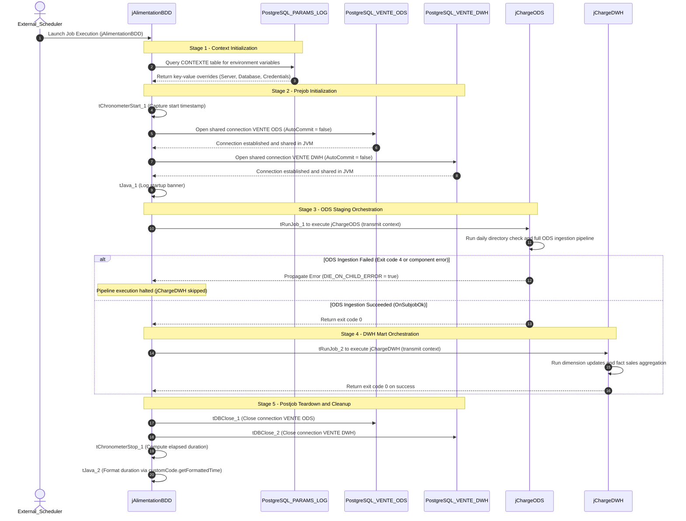

# Master Pipeline Orchestrator (jAlimentationBDD)

## Purpose and Scope

The `jAlimentationBDD` job (version `0.1`, item path `workspace://codebase/7c8eded6-9911-48de-929c-053e124fc8b5/file/ALIMENTATION_DATA_WAREHOUSE/process/Orechestration/jAlimentationBDD_0.1.item`) serves as the master execution harness for the complete warehouse alimentation cycle. It provides unified transaction scoping, execution timing, shared connection lifecycle management, and strict sequential ordering between raw staging (ODS) and analytical warehousing (DWH).

---

## Component Topology and Parameters

| Component ID | Component Type | Configuration & Technical Properties | Functional Role |
| :--- | :--- | :--- | :--- |
| `tPrejob_1` | `tPrejob` | Offset: (96, 64) | Triggers pre-execution initialization flow |
| `tChronometerStart_1` | `tChronometerStart` | Caption: `""` | Captures start epoch milliseconds into `globalMap` (`tChronometerStart_1_STARTTIME`) |
| `tDBConnection_1` | `tPostgresqlConnection` | Schema: `context.schema_ods`, Shared: `"VENTE ODS"`, `AUTO_COMMIT=false` | Opens connection to staging schema in `vente_db` |
| `tDBConnection_2` | `tPostgresqlConnection` | Schema: `context.schema_dwh`, Shared: `"VENTE DWH"`, `AUTO_COMMIT=false` | Opens connection to analytical mart schema in `vente_db` |
| `tJava_1` | `tJava` | Standard output print stream | Emits startup banner and formatted start datetime |
| `tRunJob_1` | `tRunJob` | Process: `jChargeODS`, `DIE_ON_CHILD_ERROR=true`, `TRANSMIT_WHOLE_CONTEXT=true` | Invokes ODS ingestion pipeline synchronously |
| `tRunJob_2` | `tRunJob` | Process: `jChargeDWH`, `DIE_ON_CHILD_ERROR=true`, `TRANSMIT_WHOLE_CONTEXT=true` | Invokes DWH dimensional mart pipeline synchronously |
| `tPostjob_1` | `tPostjob` | Offset: (96, 480) | Triggers teardown hooks regardless of standard flow outcome |
| `tDBClose_1` | `tPostgresqlClose` | Connection: `tDBConnection_1` | Closes connection to `VENTE_ODS` |
| `tDBClose_2` | `tPostgresqlClose` | Connection: `tDBConnection_2` | Closes connection to `VENTE_DWH` |
| `tChronometerStop_1` | `tChronometerStop` | Since Beginning: `true` | Computes elapsed time into `globalMap.get("tChronometerStop_1_DURATION")` |
| `tJava_2` | `tJava` | Standard output print stream | Emits completion banner and formatted execution duration string |

---

## Control Flow and Error Handling

1. **Failure Propagation:**
   - Both child jobs configure `DIE_ON_CHILD_ERROR = true`. If any component in `jChargeODS` fails (e.g. missing daily directory or schema violation), `jAlimentationBDD` terminates immediately with a non-zero exit code, preventing `jChargeDWH` from running on partial or corrupted staging data.
2. **Postjob Guarantees:**
   - The `tPostjob` sequence executes even on JVM shutdown signals or child errors, ensuring that database connection sockets are closed and resources freed.
3. **Implicit Context Loading:**
   - Inherits implicit database context loader reading table `PARAMS_LOG.CONTEXTE`. Values fetched override design-time defaults for `ServerName`, `database`, `port`, `utilisateur`, and `password`.

---

## Evidence Grounding

- Source definition: `workspace://codebase/7c8eded6-9911-48de-929c-053e124fc8b5/file/ALIMENTATION_DATA_WAREHOUSE/process/Orechestration/jAlimentationBDD_0.1.item`
- Context parameters: `workspace://codebase/7c8eded6-9911-48de-929c-053e124fc8b5/file/ALIMENTATION_DATA_WAREHOUSE/context/projectvariable_0.1.item`
- Formatting routine: `workspace://codebase/7c8eded6-9911-48de-929c-053e124fc8b5/file/customCode.java`
