# DWH Dimensional Mart Orchestrator (jChargeDWH)

## Purpose and Scope

The `jChargeDWH` job (version `0.1`, item path `workspace://codebase/7c8eded6-9911-48de-929c-053e124fc8b5/file/ALIMENTATION_DATA_WAREHOUSE/process/Orechestration/jChargeDWH_0.1.item`) orchestrates the dimensional modeling pipeline that extracts data from the normalized ODS schema (`VENTE_ODS`) and populates the dimensional star schema in `VENTE_DWH`.

```mermaid
sequenceDiagram
    autonumber
    actor Caller as jAlimentationBDD_Operator
    participant Orch as jChargeDWH
    participant DB_ODS as PostgreSQL_VENTE_ODS
    participant DB_DWH as PostgreSQL_VENTE_DWH
    participant J_PROD as jDwhProduit
    participant J_CLI as jDwhClient
    participant J_VTE as jDwhVente

    Caller->>Orch: Invoke jChargeDWH with context

    Note over Orch,DB_DWH: Stage 1 - Prejob Connections
    Orch->>Orch: tChronometerStart_1 (Capture start epoch)
    Orch->>DB_ODS: Open shared connection VENTE_ODS (AutoCommit = false)
    DB_ODS-->>Orch: Connection ready
    Orch->>DB_DWH: Open shared connection VENTE_DWH (AutoCommit = false)
    DB_DWH-->>Orch: Connection ready
    Orch->>Orch: tJava_1 (Log startup message)

    Note over Orch,J_VTE: Stage 2 - Sequential Dimensional Processing
    Orch->>J_PROD: tRunJob_3 (Execute jDwhProduit, transmit context)
    J_PROD->>DB_ODS: Extract active products, subcategories, categories
    J_PROD->>DB_DWH: Apply SCD Type 2 merge on DIM_PRODUIT
    J_PROD-->>Orch: OnSubjobOk (Product dimension updated)

    Orch->>J_CLI: tRunJob_1 (Execute jDwhClient, transmit context)
    J_CLI->>DB_ODS: Extract active customers and customer types
    J_CLI->>DB_DWH: Apply SCD Type 2 merge on DIM_CLIENT
    J_CLI-->>Orch: OnSubjobOk (Customer dimension updated)

    Orch->>J_VTE: tRunJob_6 (Execute jDwhVente, transmit context)
    J_VTE->>DB_ODS: Extract unpromoted sales (BL_LIGNE_IN_DWH = false)
    J_VTE->>DB_DWH: Join active dimensions, aggregate metrics, and load FAIT_VENTE
    J_VTE->>DB_ODS: Update watermark (BL_LIGNE_IN_DWH = true)
    J_VTE-->>Orch: OnSubjobOk (Fact table aggregation complete)

    Note over Orch,DB_DWH: Stage 3 - Postjob Teardown and Cleanup
    Orch->>DB_ODS: tDBClose_1 (Close connection VENTE_ODS)
    Orch->>DB_DWH: tDBClose_2 (Close connection VENTE_DWH)
    Orch->>Orch: tChronometerStop_1 (Compute elapsed time)
    Orch->>Orch: tJava_2 (Format duration via customCode.getFormattedTime and log summary)

    Orch-->>Caller: OnSubjobOk (DWH Mart Successful)
```

---

## Sequencing Rationale

The data warehouse star schema requires all dimensions to be fully populated and up-to-date before fact records can be evaluated and joined:

1. **`jDwhProduit` (Step 1):** Denormalizes product, sub-category, and category hierarchies from `ODS_PRODUIT`, `ODS_SOUS_CATEGORIE`, and `ODS_CATEGORIE`. Manages SCD-2 historical tracking in `DIM_PRODUIT`.
2. **`jDwhClient` (Step 2):** Joins `ODS_CLIENT` and `ODS_TYPE_CLIENT` to maintain SCD-2 customer records in `DIM_CLIENT`.
3. **`jDwhVente` (Step 3):** Extracts un-promoted sales records from `ODS_VENTE`, performs inner joins against `DIM_PRODUIT`, `DIM_CLIENT`, and `DIM_CALENDRIER` (previously initialized), aggregates metrics by dimension keys, and populates `FAIT_VENTE`.

If either dimension loader fails, `jDwhVente` will not execute, preventing orphaned foreign keys or inconsistent surrogate key assignments in the fact table.

---

## Connection Management

- Opens shared connections for both `VENTE_ODS` (source extraction) and `VENTE_DWH` (target upserts).
- Explicit non-auto-commit mode ensures transactional boundaries remain isolated to the individual child subjobs.
- Child jobs pass database credentials and context transparently (`TRANSMIT_WHOLE_CONTEXT=true`).

---

## Evidence Grounding

- Job design: `workspace://codebase/7c8eded6-9911-48de-929c-053e124fc8b5/file/ALIMENTATION_DATA_WAREHOUSE/process/Orechestration/jChargeDWH_0.1.item`
- Target schema scripts: `workspace://codebase/7c8eded6-9911-48de-929c-053e124fc8b5/file/scriptSQL_partie_2/2-script_create_table_dwh.sql`
