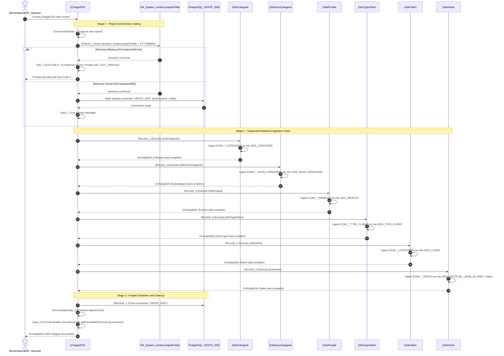

# ODS Batch Ingestion Orchestrator (jChargeODS)

## Purpose and Scope

The `jChargeODS` job (version `0.1`, item path `workspace://codebase/7c8eded6-9911-48de-929c-053e124fc8b5/file/ALIMENTATION_DATA_WAREHOUSE/process/Orechestration/jChargeODS_0.1.item`) controls the extraction of raw daily CSV feeds and feeds them into the Operational Data Store. It enforces strict relational dependency sequencing across dimensions and transactional facts, verifying file presence before loading any tables.

---

## Daily Directory Ingress Gate

Before any database operations occur, `tFileList_1` scans `context.projectFolder` looking for a directory matching `TalendDate.getDate("YYYYMMDD")`.

- **Listing Mode:** `DIRECTORIES`, `CASE_SENSITIVE=YES`, `ERROR=true`.
- **Failure Reaction:** If the directory is absent or empty, the `OnComponentError` trigger fires `tDie_1`.
- **Termination Parameters:** Message `"le repertoire du jour n'existe pas"`, Exit Code `4`, Priority `5`, `EXIT_JVM=true`.
- **Operational Impact:** This gate guarantees that jobs will never run against missing daily data or overwrite ODS tables with empty inputs.

---

## Dependency Sequence Rationale

The subjob execution order reflects strict entity relationship constraints:

1. **`jOdsCategorie`:** Loads parent product categories (`CD_CATEGORIE`).
2. **`jOdsSousCategorie`:** Loads sub-categories which depend on valid parent category references (`CD_CATEGORIE`).
3. **`jOdsProduit`:** Loads products which depend on valid sub-category references (`CD_SOUS_CATEGORIE`).
4. **`jOdsTypeClient`:** Loads customer classification tiers (`CD_TYPE_CLIENT`).
5. **`jOdsClient`:** Loads individual customer profiles which depend on valid customer type classifications (`CD_TYPE_CLIENT`).
6. **`jOdsVente`:** Ingests granular sales transactions referencing both products (`CD_PRODUIT`) and customers (`ID_CLIENT`).

Every `tRunJob` child invocation sets `DIE_ON_CHILD_ERROR=true` and `TRANSMIT_WHOLE_CONTEXT=true`.

---

## Evidence Grounding

- Item definition: `workspace://codebase/7c8eded6-9911-48de-929c-053e124fc8b5/file/ALIMENTATION_DATA_WAREHOUSE/process/Orechestration/jChargeODS_0.1.item`
- Context parameters: `workspace://codebase/7c8eded6-9911-48de-929c-053e124fc8b5/file/ALIMENTATION_DATA_WAREHOUSE/context/ConnectionODS_0.1.item`
