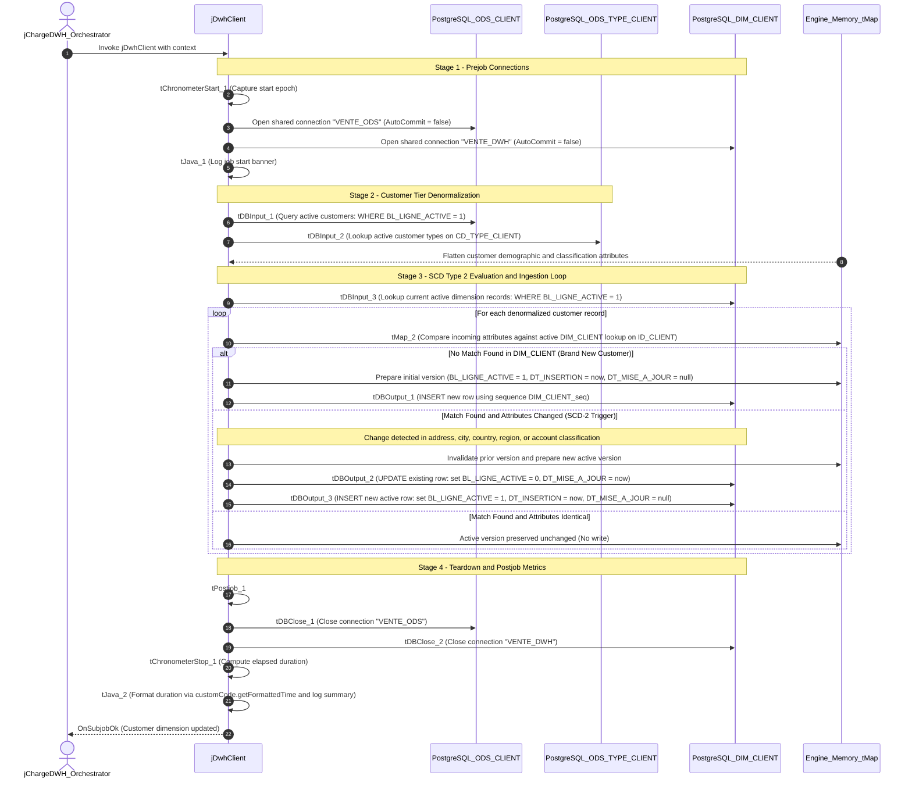

# DWH Customer Dimension Loader (jDwhClient)

## Purpose and Scope

The `jDwhClient` job (version `0.1`, item path `workspace://codebase/7c8eded6-9911-48de-929c-053e124fc8b5/file/ALIMENTATION_DATA_WAREHOUSE/process/DWH/jDwhClient_0.1.item`) extracts individual customer master records from the ODS layer, denormalizes customer type classifications, and maintains conformed customer dimension records in `VENTE_DWH.DIM_CLIENT` using Slowly Changing Dimension Type 2 (SCD-2) versioning.

---

## SCD Type 2 Comparison Attributes

A new version is triggered in `DIM_CLIENT` whenever any of the following demographic or geographical attributes change compared to the current active record:
- `NOM_CLIENT`: Customer surname.
- `PREN_CLIENT`: Customer first name.
- `CD_POSTAL_CLIENT`: Postal code.
- `VILLE_CLIENT`: City.
- `PAYS_CLIENT`: Country.
- `REGION_CLIENT`: Administrative region / territory.
- `CD_TYPE_CLIENT`: Account classification identifier.
- `LB_TYPE_CLIENT`: Classification descriptive label.

---

## Technical Component Inventory

| Component ID | Component Name | Properties & Expressions | Behavioral Function |
| :--- | :--- | :--- | :--- |
| `tPrejob_1` | `tPrejob` | Default settings | Initiates initialization sequence |
| `tChronometerStart_1` | `tChronometerStart` | Key: `tChronometerStart_1_STARTTIME` | Records start timestamp in memory |
| `tDBConnection_1` | `tPostgresqlConnection` | Shared: `"VENTE_ODS"`, `AUTO_COMMIT=false` | Connects to PostgreSQL staging schema |
| `tDBConnection_2` | `tPostgresqlConnection` | Shared: `"VENTE_DWH"`, `AUTO_COMMIT=false` | Connects to PostgreSQL warehouse schema |
| `tDBInput_1` | `tPostgresqlInput` | `SELECT * FROM "VENTE_ODS"."ODS_CLIENT" WHERE "BL_LIGNE_ACTIVE" = 1` | Primary extraction stream |
| `tDBInput_2` | `tPostgresqlInput` | `SELECT * FROM "VENTE_ODS"."ODS_TYPE_CLIENT" WHERE "BL_LIGNE_ACTIVE" = 1` | Lookup customer types |
| `tMap_1` | `tMap` | Inner join on `CD_TYPE_CLIENT` | Denormalizes customer classification label |
| `tDBInput_3` | `tPostgresqlInput` | `SELECT * FROM "VENTE_DWH"."DIM_CLIENT" WHERE "BL_LIGNE_ACTIVE" = 1` | Active dimension lookup stream |
| `tMap_2` | `tMap` | Attribute comparator: detects address/name/tier changes | Directs SCD-2 version routing |
| `tDBOutput_1` | `tPostgresqlOutput` | Table: `"DIM_CLIENT"`, Action: `INSERT` | Appends new initial customer versions |
| `tDBOutput_2` | `tPostgresqlOutput` | Table: `"DIM_CLIENT"`, Action: `UPDATE` | Deactivates superseded rows (`BL_LIGNE_ACTIVE=0`) |
| `tDBOutput_3` | `tPostgresqlOutput` | Table: `"DIM_CLIENT"`, Action: `INSERT` | Appends updated active customer versions |
| `tPostjob_1` | `tPostjob` | Default settings | Triggers post-execution hooks |
| `tDBClose_1` | `tPostgresqlClose` | Connection: `tDBConnection_1` | Closes connection to `VENTE_ODS` |
| `tDBClose_2` | `tPostgresqlClose` | Connection: `tDBConnection_2` | Closes connection to `VENTE_DWH` |
| `tChronometerStop_1` | `tChronometerStop` | Standard stopwatch | Calculates elapsed runtime |
| `tJava_2` | `tJava` | Standard print stream | Prints completion duration banner |

---

## Evidence Grounding

- Item definition: `workspace://codebase/7c8eded6-9911-48de-929c-053e124fc8b5/file/ALIMENTATION_DATA_WAREHOUSE/process/DWH/jDwhClient_0.1.item`
- Physical DDL: `workspace://codebase/7c8eded6-9911-48de-929c-053e124fc8b5/file/scriptSQL_partie_2/2-script_create_table_dwh.sql` (lines 38-57)
