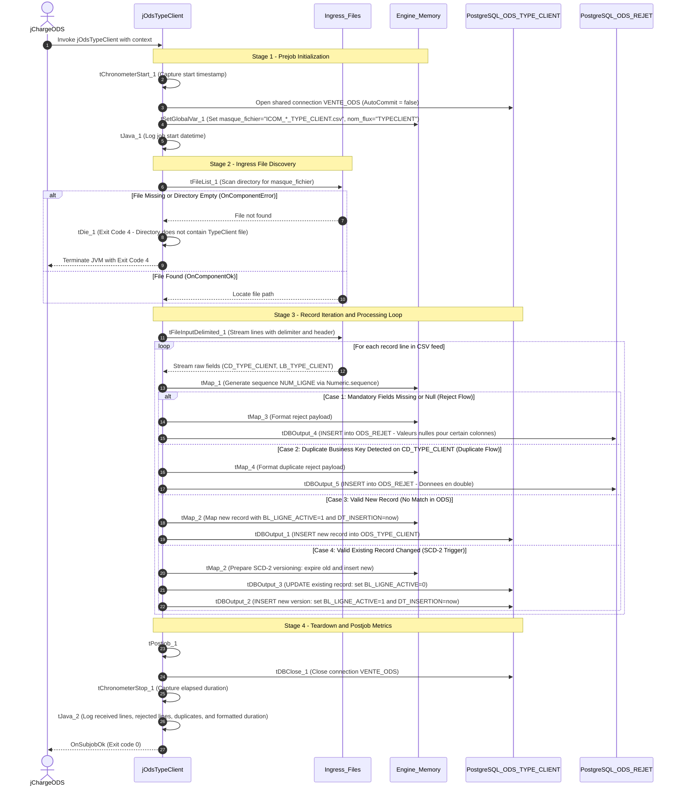

# ODS Customer Type Loader (jOdsTypeClient)

## Purpose and Scope

The `jOdsTypeClient` job (version `0.1`, item path `workspace://codebase/7c8eded6-9911-48de-929c-053e124fc8b5/file/ALIMENTATION_DATA_WAREHOUSE/process/ODS/jOdsTypeClient_0.1.item`) extracts customer account classification definitions from daily delimited flat files (`ICOM_*_TYPE_CLIENT.csv`), enforces mandatory code and label completeness, quarantines duplicates, and manages SCD Type 2 active versioning in `VENTE_ODS.ODS_TYPE_CLIENT`.

---

## Technical Component Inventory

| Component ID | Component Name | Properties & Expressions | Behavioral Function |
| :--- | :--- | :--- | :--- |
| `tPrejob_1` | `tPrejob` | Default settings | Initiates initialization sequence |
| `tChronometerStart_1` | `tChronometerStart` | Key: `tChronometerStart_1_STARTTIME` | Records start timestamp in memory |
| `tDBConnection_1` | `tPostgresqlConnection` | Shared: `"VENTE_ODS"`, `AUTO_COMMIT=false` | Connects to PostgreSQL staging schema |
| `tSetGlobalVar_1` | `tSetGlobalVar` | `masque_fichier="ICOM_*_TYPE_CLIENT.csv"` `nom_flux="TYPE_CLIENT"` | Registers feed mask and flow name in global scope |
| `tFileList_1` | `tFileList` | Dir: `context.projectFolder + TalendDate.getDate("YYYYMMDD")` | Scans for daily customer type flat file |
| `tDie_1` | `tDie` | Message: `"Le repertoire ne contient pas de fichier Type Client"`, Code: `4`, Exit: `true` | Halts execution if file is missing |
| `tFileInputDelimited_1` | `tFileInputDelimited` | File: `tFileList_1_CURRENT_FILEPATH`, Delimiter: `context.fieldSeparator` | Parses delimited text rows |
| `tMap_1` | `tMap` | `NUM_LIGNE = Numeric.sequence("s1", 1, 1)` | Stamped artificial sequence number |
| `tFilterRow_1` | `tFilterRow` | `!CD_TYPE_CLIENT.isEmpty() && !LB_TYPE_CLIENT.isEmpty()` | Discards empty/null keys |
| `tMap_3` | `tMap` | Message: `"Valeurs nulles pour certain colonnes"` | Prepares filter reject audit record |
| `tDBOutput_4` | `tPostgresqlOutput` | Table: `"ODS_REJET"`, Action: `INSERT` | Appends null rejects to quarantine log |
| `tUniqRow_1` | `tUniqRow` | Key attribute: `CD_TYPE_CLIENT` | Filters in-file duplicate keys |
| `tMap_4` | `tMap` | Message: `"Donnees en double"` | Prepares duplicate reject audit record |
| `tDBOutput_5` | `tPostgresqlOutput` | Table: `"ODS_REJET"`, Action: `INSERT` | Appends duplicate rejects to quarantine log |
| `tDBInput_1` | `tPostgresqlInput` | Query: `SELECT * FROM "VENTE_ODS"."ODS_TYPE_CLIENT"` | Feeds active lookup records to tMap_2 |
| `tMap_2` | `tMap` | Multi-output split: `insertTypeClient`, `UpdateBICurrent`, `insertNewCurrent` | Evaluates SCD Type 2 state |
| `tDBOutput_1` | `tPostgresqlOutput` | Table: `"ODS_TYPE_CLIENT"`, Action: `INSERT` | Inserts brand new customer types |
| `tDBOutput_3` | `tPostgresqlOutput` | Table: `"ODS_TYPE_CLIENT"`, Action: `UPDATE` | Deactivates superseded historical versions (`BL_LIGNE_ACTIVE=0`) |
| `tDBOutput_2` | `tPostgresqlOutput` | Table: `"ODS_TYPE_CLIENT"`, Action: `INSERT` | Inserts updated active customer type version (`BL_LIGNE_ACTIVE=1`) |
| `tPostjob_1` | `tPostjob` | Default settings | Triggers post-execution hooks |
| `tDBClose_1` | `tPostgresqlClose` | Connection: `tDBConnection_1` | Gracefully closes connection socket |
| `tChronometerStop_1` | `tChronometerStop` | Standard stopwatch | Calculates elapsed runtime |
| `tJava_2` | `tJava` | Standard print stream | Prints received, rejected, and duplicate record totals |

---

## Evidence Grounding

- Item definition: `workspace://codebase/7c8eded6-9911-48de-929c-053e124fc8b5/file/ALIMENTATION_DATA_WAREHOUSE/process/ODS/jOdsTypeClient_0.1.item`
- Physical table DDL: `workspace://codebase/7c8eded6-9911-48de-929c-053e124fc8b5/file/scriptSQL_partie_1/2-script_create_table_ods.sql` (lines 13-21)
