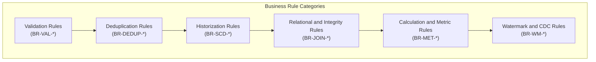

# Business Rules and Transformation Logic Catalog

## Purpose and Scope

This catalog formalizes all business rules implemented in the Talend Data Warehouse Alimentation system. Each rule is assigned a stable business rule identifier (`BR-*`), categorized by policy area, and traced directly to source components and expressions.

---

## Catalog of Formal Business Rules

### 1. Ingress Validation Rules BR-VAL
| Rule ID | Name | Target Entity | Enforcement Component & Expression | Consequence of Violation |
| :--- | :--- | :--- | :--- | :--- |
| **BR-VAL-001** | Daily Folder Gate | Ingress Files | `tFileList_1` in `jChargeODS` `TalendDate.getDate("YYYYMMDD")` | Pipeline terminates immediately (`tDie`, exit code 4). |
| **BR-VAL-002** | Mandatory Category Keys | Category Feed | `tFilterRow_1` in `jOdsCategorie` `!input_row.CD_CATEGORIE.isEmpty() && !input_row.LB_CATEGORIE.isEmpty()` | Row redirected to `ODS_REJET` ("Valeurs nulles pour certain colonnes"). |
| **BR-VAL-003** | Mandatory Subcategory Keys | Subcategory Feed | `tFilterRow_1` in `jOdsSousCategorie` `!CD_SOUS_CATEGORIE.isEmpty() && !LB_SOUS_CATEGORIE.isEmpty() && !CD_CATEGORIE.isEmpty()` | Row redirected to `ODS_REJET`. |
| **BR-VAL-004** | Mandatory Product Attributes | Product Feed | `tFilterRow_1` in `jOdsProduit` Keys non-empty, purchase & sales prices non-null | Row redirected to `ODS_REJET`. |
| **BR-VAL-005** | Mandatory Customer Attributes | Customer Feed | `tFilterRow_1` in `jOdsClient` `ID_CLIENT`, names, city, country, region, type non-empty | Row redirected to `ODS_REJET`. |
| **BR-VAL-006** | Mandatory Sales Attributes | Sales Feed | `tFilterRow_1` in `jOdsVente` `ID_VENTE`, `CD_PRODUIT`, `DT_VENTE`, `ID_CLIENT`, `QTE_VENTE`, `PRIX` non-null | Row redirected to `ODS_REJET`. |

---

### 2. Deduplication Rules BR-DEDUP
| Rule ID | Name | Target Entity | Component & Key Scope | Policy |
| :--- | :--- | :--- | :--- | :--- |
| **BR-DEDUP-001** | Unique Category Code | `ODS_CATEGORIE` | `tUniqRow_1` on `CD_CATEGORIE` | First occurrence passes; duplicates routed to `ODS_REJET` ("Donnees en double"). |
| **BR-DEDUP-002** | Unique Subcategory Code | `ODS_SOUS_CATEGORIE`| `tUniqRow_1` on `CD_SOUS_CATEGORIE` | First occurrence passes; duplicates routed to `ODS_REJET`. |
| **BR-DEDUP-003** | Unique Product Code | `ODS_PRODUIT` | `tUniqRow_1` on `CD_PRODUIT` | First occurrence passes; duplicates routed to `ODS_REJET`. |
| **BR-DEDUP-004** | Unique Customer ID | `ODS_CLIENT` | `tUniqRow_1` on `ID_CLIENT` | First occurrence passes; duplicates routed to `ODS_REJET`. |
| **BR-DEDUP-005** | Unique Sales Line Item | `ODS_VENTE` | `tUniqRow_1` on `ID_VENTE` + `CD_PRODUIT` | First occurrence passes; duplicates routed to `ODS_REJET`. |

---

### 3. Historization Rules BR-SCD
| Rule ID | Name | Target Entity | Mechanism & Trigger |
| :--- | :--- | :--- | :--- |
| **BR-SCD-001** | ODS Active Versioning | All ODS Tables | Active rows carry `BL_LIGNE_ACTIVE = 1`. If an incoming entity has modified attributes compared to the active record, the existing row is updated to `BL_LIGNE_ACTIVE = 0` and a new version inserted with `BL_LIGNE_ACTIVE = 1`. |
| **BR-SCD-002** | DWH Product Historization | `DIM_PRODUIT` | Supercedes active version when price, name, or category parent changes. Old version: `BL_LIGNE_ACTIVE = 0`, `DT_MISE_A_JOUR = now()`. New version: `BL_LIGNE_ACTIVE = 1`, `DT_INSERTION = now()`. |
| **BR-SCD-003** | DWH Customer Historization | `DIM_CLIENT` | Supercedes active version when address, region, or customer type changes. Same timestamp and active flag semantics as BR-SCD-002. |

---

### 4. Metrics and Financial Formulas BR-MET
| Rule ID | Name | Formula Expression | Context / Component |
| :--- | :--- | :--- | :--- |
| **BR-MET-001** | Line Purchase Amount | `MT_ACHAT = QTE_VENTE * PRIX_ACHAT` | Computed per sales line item in `jDwhVente.tMap_1`. |
| **BR-MET-002** | Line Gross Sales Amount | `MT_VENTE = QTE_VENTE * PRIX_VENTE` | Computed per sales line item in `jDwhVente.tMap_1`. |
| **BR-MET-003** | Fact Sales Transaction Count | `NB_VENTE = count(ID_VENTE)` | Aggregated in `jDwhVente.tAggregateRow_1` by dimension tuple. |
| **BR-MET-004** | Fact Quantity Total | `NB_QTE_VENTE = count(ID_DIM_PRODUIT)` | Aggregated in `jDwhVente.tAggregateRow_1`. |
| **BR-MET-005** | Fact Cost Total | `NB_MT_ACHAT = sum(MT_ACHAT)` | Aggregated total wholesale cost in `jDwhVente.tAggregateRow_1`. |
| **BR-MET-006** | Fact Gross Sales Total | `NB_MT_VENTE = sum(MT_VENTE)` | Aggregated total revenue in `jDwhVente.tAggregateRow_1`. |

---

### 5. Integrity and Watermarking Rules BR-JOIN and BR-WM
| Rule ID | Name | Rule Logic |
| :--- | :--- | :--- |
| **BR-JOIN-001** | Conformed Fact Lookups | Sales fact generation performs strict `innerJoin="true"` lookups against `DIM_PRODUIT` (`BL_LIGNE_ACTIVE=1`), `DIM_CLIENT` (`BL_LIGNE_ACTIVE=1`), and `DIM_CALENDRIER`. Unmatched sales lines are dropped from the fact mart. |
| **BR-WM-001** | Sales Staging Watermark | Sales lines in `ODS_VENTE` start with `BL_LIGNE_IN_DWH = false`. Upon successful loading into `FAIT_VENTE`, the job sets `BL_LIGNE_IN_DWH = true`. Only un-promoted lines are eligible for fact loading. |

---

## Evidence Grounding

- Field expressions in `jOdsCategorie`, `jOdsClient`, `jOdsProduit`, `jOdsVente`
- DWH aggregation in `jDwhVente`: `workspace://codebase/7c8eded6-9911-48de-929c-053e124fc8b5/file/ALIMENTATION_DATA_WAREHOUSE/process/DWH/jDwhVente_0.1.item`
