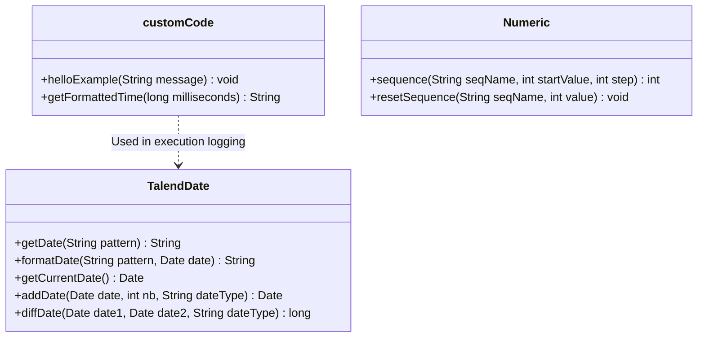

# Custom Java Routines and System Routine Catalog

## Purpose and Scope

Talend jobs rely on reusable Java routines located in `routines.*` packages. This document documents the user-defined routine `customCode.java` as well as core system routines leveraged throughout the ETL flows.

---

## User Routine routines.customCode

### Routine Overview
- Source Path: `workspace://codebase/7c8eded6-9911-48de-929c-053e124fc8b5/file/customCode.java` and `ALIMENTATION_DATA_WAREHOUSE/code/routines/customCode_0.1.item`.
- Package: `routines`
- Class: `public class customCode`

### Method getFormattedTime
- Converts raw millisecond duration into hours, minutes, and seconds (`Xs`, `Xm Ys`, `Xh Ym Zs`).
- Used in `tJava` post-execution summary components across all jobs.

### Method helloExample
- Boilerplate template routine provided by Talend Open Studio.

---

## Core System Routines

The following built-in Talend system routines are imported and executed across the jobs:

| Routine Class | Methods Invoked | Usage in Pipelines |
| :--- | :--- | :--- |
| `routines.system.TalendDate` | `getDate("YYYYMMDD")` `formatDate("yyyy-MM-dd HH:mm:ss", ...)` `getCurrentDate()` | Daily directory naming, execution logging banners, audit timestamping (`DT_INSERTION`, `DT_REJET`) |
| `routines.system.Numeric` | `sequence(seqName, start, step)` | Line numbering generation (`NUM_LIGNE`) in `tMap_1` across all ODS jobs |
| `routines.system.StringHandling` | `LEN()`, `TRIM()`, `UPCASE()` | String cleaning and normalization |
| `routines.system.DataOperation` | Type casting and arithmetic | Numeric price conversions |
| `routines.system.Relational` | Null checking and comparisons | Expression evaluation in filter rows |

---

## Evidence Grounding

- Routine source: `workspace://codebase/7c8eded6-9911-48de-929c-053e124fc8b5/file/customCode.java`
- Job imports: Verified in `jAlimentationBDD_0.1.item` and `jChargeODS_0.1.item`
