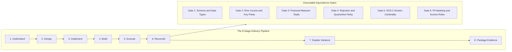

# Functional Equivalence and Multi-Gate Reconciliation Contract

## Purpose and Scope

This document specifies the **formal, executable equivalence contract** between the legacy **Talend Open Studio ETL** workload and any modernized target implementation (including the **Azure Databricks PySpark Lakehouse** target), adhering to the `talend-equivalence-contract` skill specification.

Equivalence is not assumed from code translation or build success alone. It requires multi-gate parallel-run validation across data measures, rejection quarantine streams, operational behaviors, and data privacy controls.

---

## Multi-Gate Equivalence Criteria Matrix

| Verification Gate | Source Legacy Metric (PostgreSQL) | Modernized Target Metric (Delta Lake) | Acceptance Condition | Strict Tolerance |
| :--- | :--- | :--- | :--- | :--- |
| **Gate 1: Fact Row Count** | `COUNT(*)` in `VENTE_DWH.FAIT_VENTE` | `count(*)` in `gold.fact_vente` | Exact row-level match | **0% difference** |
| **Gate 2: Gross Sales Revenue** | `SUM(NB_MT_VENTE)` in `FAIT_VENTE` | `SUM(nb_mt_vente)` in `gold.fact_vente` | Exact currency balance | **$0.00** |
| **Gate 3: Wholesale Cost Total** | `SUM(NB_MT_ACHAT)` in `FAIT_VENTE` | `SUM(nb_mt_achat)` in `gold.fact_vente` | Exact currency balance | **$0.00** |
| **Gate 4: Total Units Sold** | `SUM(NB_QTE_VENTE)` in `FAIT_VENTE` | `SUM(nb_qte_vente)` in `gold.fact_vente` | Exact integer match | **0 units** |
| **Gate 5: Total Transactions** | `SUM(NB_VENTE)` in `FAIT_VENTE` | `SUM(nb_vente)` in `gold.fact_vente` | Exact order count match | **0 units** |
| **Gate 6: Rejection Quarantine**| `COUNT(*)` in `VENTE_ODS.ODS_REJET` | `count(*)` in `silver_quarantine_rejets` | Nulls and duplicates match | **0% difference** |
| **Gate 7: SCD-2 Active State** | `COUNT(*)` where `BL_LIGNE_ACTIVE = 1` | `count(*)` where `is_active = 1` | Distinct active business keys | **0% difference** |
| **Gate 8: Watermark Integrity** | Rows with `BL_LIGNE_IN_DWH = true` | Rows with `bl_ligne_in_dwh = true` | Exact synchronization state | **0% difference** |
| **Gate 9: PII Query Security** | Plaintext in `DIM_CLIENT` | `nom_client` masked for standard roles | Reader sees `D***`; Compliance sees cleartext | **Verified** |

---

## Rejection and Anomaly Parity Standards

The "No Lost Rejects" principle requires that error streams be reconciled as rigorously as success tables:
1. **Null Violations (`BR-VAL-*`):** Any record with missing mandatory keys must appear in `silver_quarantine_rejets` with message `"Valeurs nulles pour certain colonnes"`.
2. **Duplicate Violations (`BR-DEDUP-*`):** Any record containing duplicate natural keys must appear in `silver_quarantine_rejets` with message `"Donnees en double"`.
3. **Payload Fidelity:** Quarantined rows must preserve original source file name, line sequence number, and raw delimited payload string without truncation.

---

## Operational and Fault-Tolerance Equivalence

1. **Ingress Directory Failure:** If the daily date directory `{projectFolder}/{YYYYMMDD}/` is absent, the modernized job must terminate cleanly with an exit code equivalent to `4` without performing partial writes.
2. **Atomic Watermark Sync:** Updating `bl_ligne_in_dwh = true` in staging must commit within the same transactional boundary as fact insertion. If fact table writing fails, watermark updates must roll back, ensuring zero unpromoted data loss.
3. **Rerun Idempotency:** Executing the pipeline twice against identical daily input files must not alter fact table metrics or duplicate dimension records.

---

## Evidence Grounding

- DWH fact loading: `workspace://codebase/7c8eded6-9911-48de-929c-053e124fc8b5/file/ALIMENTATION_DATA_WAREHOUSE/process/DWH/jDwhVente_0.1.item`
- ODS reject tables: `workspace://codebase/7c8eded6-9911-48de-929c-053e124fc8b5/file/scriptSQL_partie_1/2-script_create_table_ods.sql` (lines 114-127)
- DWH table schema: `workspace://codebase/7c8eded6-9911-48de-929c-053e124fc8b5/file/scriptSQL_partie_2/2-script_create_table_dwh.sql`
- Automated reconciler: `workspace://codebase/7c8eded6-9911-48de-929c-053e124fc8b5/file/databricks/tests/equivalence/reconcile_talend_vs_databricks.py`
