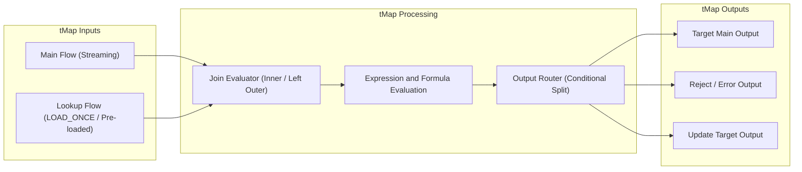

# tMap Mappings, Joins, and Expression Matrix

## Purpose and Scope

The `tMap` component is the primary transformation and join engine across the Talend pipeline. This reference catalogs the structural mappings, lookup join behaviors, filter conditions, and Java expressions utilized across each `tMap` instance in the estate.

---

## Detailed tMap Instance Catalog

### 1. Ingestion Sequence Mapping (tMap_1 in ODS Jobs)
- **Role:** Adds artificial record sequencing to flat file lines.
- **Join Mode:** None (Single input stream).
- **Key Expressions:**
  - `NUM_LIGNE`: `Numeric.sequence("s1", 1, 1)`
  - Other attributes passed through directly (`row1.COLUMN`).

### 2. ODS SCD-2 Resolution Mapping (tMap_2 in ODS Jobs)
- **Role:** Evaluates incoming clean records against current ODS table contents.
- **Lookup Input:** `tDBInput_1` (`SELECT * FROM "VENTE_ODS"."..."`)
  - `lookupMode = LOAD_ONCE`, `matchingMode = UNIQUE_MATCH`
- **Output Tables:**
  1. `insert...`: Filter condition `lookup.KEY == null`. Inserts brand new entity with `BL_LIGNE_ACTIVE = 1`.
  2. `UpdateBICurrent`: Filter condition `lookup.KEY != null && changed(...)`. Emits update flow setting `BL_LIGNE_ACTIVE = 0` on historical record.
  3. `insertNewCurrent`: Filter condition `lookup.KEY != null && changed(...)`. Emits insert flow for new active version with `BL_LIGNE_ACTIVE = 1`.

### 3. Reject Formatting Mappings (tMap_3 and tMap_4 in ODS Jobs)
- **Role:** Translates raw reject streams into structured `ODS_REJET` records.
- **Output Table:** `insertRejet` / `insertDuplicate`
  - `LB_CHEMIN_FICHIER`: `((String)globalMap.get("tFileList_1_CURRENT_FILEPATH"))`
  - `LB_NOM_FICHIER`: `((String)globalMap.get("tFileList_1_CURRENT_FILE"))`
  - `NUM_LIGNE_REJET`: `row.NUM_LIGNE`
  - `LB_LIGNE_REJET`: String concatenation of row elements separated by pipe (`'\|'`)
  - `LB_MESSAGE_REJET`: Literal `"Valeurs nulles pour certain colonnes"` (filter rejects) or `"Donnees en double"` (duplicate rejects)
  - `LB_NOM_FLUX`: `((String)globalMap.get("nom_flux"))`
  - `DT_REJET`: `TalendDate.getCurrentDate()`
  - `LB_JOB_NAME`: `jobName`

### 4. DWH Fact Join Mapping (tMap_1 in jDwhVente)
- **Main Stream:** `ODS_VENTE` (`WHERE BL_LIGNE_IN_DWH = False`)
- **Lookups:**
  - `DIM_PRODUIT` (`row2`): Inner join on `CD_PRODUIT`, `WHERE BL_LIGNE_ACTIVE = 1`
  - `DIM_CLIENT` (`row4`): Inner join on `ID_CLIENT`, `WHERE BL_LIGNE_ACTIVE = 1`
  - `DIM_CALENDRIER` (`row3`): Inner join on `DT_VENTE = DT_JOUR`
- **Output Expressions (`venteToInsert`):**
  - `ID_DIM_PRODUIT`: `row2.ID_DIM_PRODUIT`
  - `ID_DIM_CLIENT`: `row4.ID_DIM_CLIENT`
  - `ID_DIM_CALENDRIER`: `row3.ID_DIM_CALENDRIER`
  - `MT_ACHAT`: `row1.QTE_VENTE * row1.PRIX_ACHAT`
  - `MT_VENTE`: `row1.QTE_VENTE * row1.PRIX_VENTE`
  - `QTE_VENTE`: `row1.QTE_VENTE`

### 5. DWH Fact Watermarking Mapping (tMap_3 in jDwhVente)
- **Main Stream:** Cached in-memory stream from `tHashInput_2`.
- **Output Table (`venteToUpdate`):**
  - `ID_VENTE`: `row7.ID_VENTE`
  - `CD_PRODUIT`: `row7.CD_PRODUIT`
  - `BL_LIGNE_IN_DWH`: Boolean constant `true`

---

## Evidence Grounding

- Component definitions and metadata:
  - `workspace://codebase/7c8eded6-9911-48de-929c-053e124fc8b5/file/ALIMENTATION_DATA_WAREHOUSE/process/ODS/jOdsCategorie_0.1.item`
  - `workspace://codebase/7c8eded6-9911-48de-929c-053e124fc8b5/file/ALIMENTATION_DATA_WAREHOUSE/process/DWH/jDwhVente_0.1.item`
