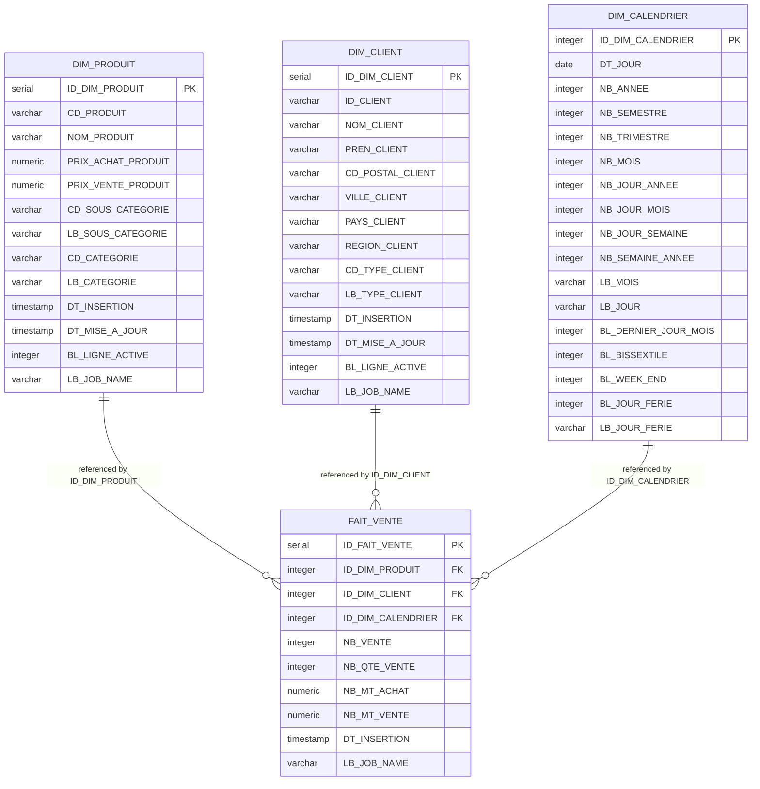

# Data Warehouse (DWH) Star Schema and Table Models

## Purpose and Scope

The analytical Data Warehouse schema `VENTE_DWH` implements a conformed dimensional star schema optimized for business intelligence, OLAP cube construction, and sales performance reporting.

The model separates slowly changing business entities into conformed dimensions (`DIM_PRODUIT`, `DIM_CLIENT`, `DIM_CALENDRIER`) surrounding a central aggregated sales fact table (`FAIT_VENTE`).

---

## Star Schema Dimension Details

### 1. Dimension DIM_PRODUIT
- **Surrogate Primary Key:** `ID_DIM_PRODUIT` (`SERIAL NOT NULL`).
- **Natural Business Key:** `CD_PRODUIT` (`VARCHAR(50)`).
- **Denormalized Hierarchy:**
  - Product Level: `NOM_PRODUIT`, `PRIX_ACHAT_PRODUIT`, `PRIX_VENTE_PRODUIT`.
  - Sub-Category Level: `CD_SOUS_CATEGORIE`, `LB_SOUS_CATEGORIE`.
  - Category Level: `CD_CATEGORIE`, `LB_CATEGORIE`.
- **SCD Type 2 Historization Columns:**
  - `DT_INSERTION` (`TIMESTAMP NOT NULL`): Version creation time.
  - `DT_MISE_A_JOUR` (`TIMESTAMP`): Expiration timestamp when superseded.
  - `BL_LIGNE_ACTIVE` (`INTEGER NOT NULL`): `1` for the current active version; `0` for expired historical versions.

### 2. Dimension DIM_CLIENT
- **Surrogate Primary Key:** `ID_DIM_CLIENT` (`SERIAL NOT NULL`).
- **Natural Business Key:** `ID_CLIENT` (`VARCHAR(50)`).
- **Attributes:**
  - Demographic: `NOM_CLIENT`, `PREN_CLIENT`.
  - Geography: `CD_POSTAL_CLIENT`, `VILLE_CLIENT`, `PAYS_CLIENT`, `REGION_CLIENT`.
  - Classification: `CD_TYPE_CLIENT`, `LB_TYPE_CLIENT`.
- **SCD Type 2 Historization Columns:**
  - `DT_INSERTION`, `DT_MISE_A_JOUR`, `BL_LIGNE_ACTIVE`, `LB_JOB_NAME`.

### 3. Dimension DIM_CALENDRIER
- **Natural Integer Primary Key:** `ID_DIM_CALENDRIER` (`INTEGER NOT NULL`, e.g. `20250605`).
- **Calendar Attributes:** Full year, semester, quarter, month, day, weekday, leap year, month-end, and public holiday indicators.

---

## Fact Table Specification FAIT_VENTE

The `FAIT_VENTE` table represents daily summarized sales performance grouped by product, customer, and date.

- **Primary Key:** `ID_FAIT_VENTE` (`SERIAL NOT NULL`).
- **Foreign Keys:**
  - `ID_DIM_PRODUIT` -> references `DIM_PRODUIT(ID_DIM_PRODUIT)` (`CONSTRAINT "FAIT_VENTE_PRODUIT_FKEY"`).
  - `ID_DIM_CLIENT` -> references `DIM_CLIENT(ID_DIM_CLIENT)` (`CONSTRAINT "FAIT_VENTE_CLIENT_FKEY"`).
  - `ID_DIM_CALENDRIER` -> references `DIM_CALENDRIER(ID_DIM_CALENDRIER)` (`CONSTRAINT "FAIT_VENTE_CALENDRIER_FKEY"`).
- **Aggregated Metric Measures:**
  - `NB_VENTE` (`INTEGER NOT NULL`): Count of transactions.
  - `NB_QTE_VENTE` (`INTEGER NOT NULL`): Sum of units sold.
  - `NB_MT_ACHAT` (`NUMERIC NOT NULL`): Total wholesale cost (`sum(QTE * PRIX_ACHAT)`).
  - `NB_MT_VENTE` (`NUMERIC NOT NULL`): Total gross revenue (`sum(QTE * PRIX_VENTE)`).
- **Lineage Metadata:**
  - `DT_INSERTION` (`TIMESTAMP NOT NULL`), `LB_JOB_NAME` (`VARCHAR(100) NOT NULL`).

---

## Evidence Grounding

- Target DDL script: `workspace://codebase/7c8eded6-9911-48de-929c-053e124fc8b5/file/scriptSQL_partie_2/2-script_create_table_dwh.sql`
- Validation queries: `workspace://codebase/7c8eded6-9911-48de-929c-053e124fc8b5/file/scriptSQL_partie_2/5-script_select_table_dwh.sql`
