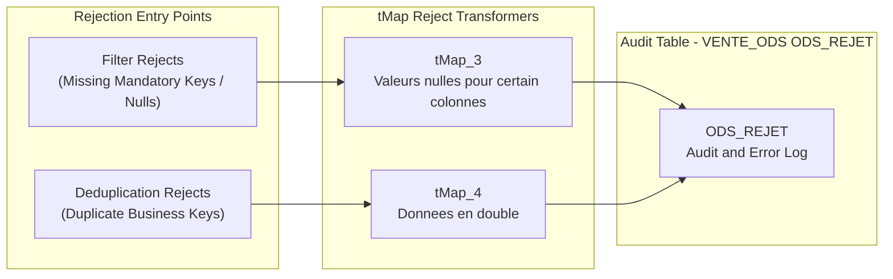

# Reject and Anomaly Logging Model (ODS_REJET)

## Purpose and Scope

The `ODS_REJET` table (hosted in schema `VENTE_ODS`) captures all records rejected during ODS ingestion. It functions as an audit trail and data quality quarantine repository, capturing raw payload lines, source file names, line numbers, error descriptions, and originating flow names.



---

## Physical Table Structure

```sql
CREATE TABLE "VENTE_ODS"."ODS_REJET" 
(
    "LB_CHEMIN_FICHIER" VARCHAR(255) NOT NULL,
    "LB_NOM_FICHIER"    VARCHAR(100) NOT NULL,	
    "NUM_LIGNE_REJET"   INTEGER      NOT NULL,
    "LB_LIGNE_REJET"    VARCHAR(500) NOT NULL,
    "LB_MESSAGE_REJET"  VARCHAR(100) NOT NULL,
    "LB_NOM_FLUX"       VARCHAR(100) NOT NULL,
    "DT_REJET"          TIMESTAMP    NOT NULL,
    "LB_JOB_NAME"       VARCHAR(100) NOT NULL
);
```

### Column Descriptions

| Column | Type | Nullable | Description & Derivation |
| :--- | :--- | :--- | :--- |
| `LB_CHEMIN_FICHIER` | `VARCHAR(255)` | No | Complete file path from `((String)globalMap.get("tFileList_1_CURRENT_FILEPATH"))` |
| `LB_NOM_FICHIER` | `VARCHAR(100)` | No | File basename from `((String)globalMap.get("tFileList_1_CURRENT_FILE"))` |
| `NUM_LIGNE_REJET` | `INTEGER` | No | 1-based source row sequence number computed by `Numeric.sequence` in `tMap_1` |
| `LB_LIGNE_REJET` | `VARCHAR(500)` | No | String concatenation of source line attributes (e.g. `col1 + '\|' + col2`) |
| `LB_MESSAGE_REJET` | `VARCHAR(100)` | No | Rejection classification: `"Valeurs nulles pour certain colonnes"` or `"Donnees en double"` |
| `LB_NOM_FLUX` | `VARCHAR(100)` | No | Flow identifier from global variable (`CATEGORIE`, `PRODUIT`, `CLIENT`, `VENTE`, etc.) |
| `DT_REJET` | `TIMESTAMP` | No | Rejection timestamp (`TalendDate.getCurrentDate()`) |
| `LB_JOB_NAME` | `VARCHAR(100)` | No | Calling job name (`jobName`) |

---

## Reject Categories and Data Quality Policies

1. **Mandatory Field Null Violations:**
   - Filter condition: Evaluated in `tFilterRow_1`. If key business identifiers or non-nullable attributes are empty, the record is discarded from the main path and routed to `ODS_REJET` with label `"Valeurs nulles pour certain colonnes"`.
2. **Duplicate Business Key Violations:**
   - Deduplication condition: Evaluated in `tUniqRow_1` across key attributes (e.g. `CD_CATEGORIE`, `CD_PRODUIT`, or `ID_VENTE + CD_PRODUIT`). Duplicate occurrences beyond the first appearance are quarantined in `ODS_REJET` with label `"Donnees en double"`.

---

## Evidence Grounding

- Table DDL: `workspace://codebase/7c8eded6-9911-48de-929c-053e124fc8b5/file/scriptSQL_partie_1/2-script_create_table_ods.sql` (lines 114-127)
- Reject mapping logic: `workspace://codebase/7c8eded6-9911-48de-929c-053e124fc8b5/file/ALIMENTATION_DATA_WAREHOUSE/process/ODS/jOdsCategorie_0.1.item` (lines 900-980)
