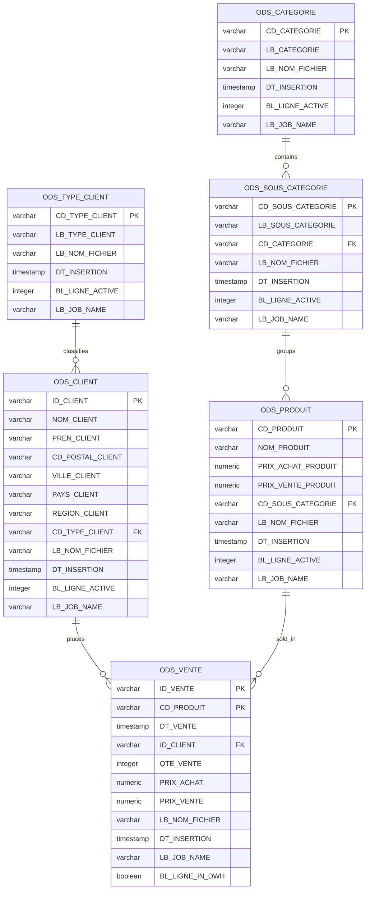

# Operational Data Store (ODS) Table Specifications

## Purpose and Scope

The **Operational Data Store (ODS)** is hosted in the PostgreSQL database `vente_db` under schema `VENTE_ODS`. It acts as a standardized, quality-controlled, persistent operational repository between file ingress and analytical data mart loading.

All tables in `VENTE_ODS` share standard audit columns to track data provenance, execution lifecycle, and active version status.

---

## Detailed Table Catalogs

### 1. Table ODS_TYPE_CLIENT
- **Purpose:** Stores customer account classifications (e.g. Retail, Wholesale, Corporate).
- **Columns:**
  - `CD_TYPE_CLIENT` `VARCHAR(50) NOT NULL`: Business code / primary key.
  - `LB_TYPE_CLIENT` `VARCHAR(100) NOT NULL`: Descriptive label.
  - Audit metadata: `LB_NOM_FICHIER`, `DT_INSERTION`, `BL_LIGNE_ACTIVE`, `LB_JOB_NAME`.

### 2. Table ODS_CATEGORIE
- **Purpose:** High-level product category classification.
- **Columns:**
  - `CD_CATEGORIE` `VARCHAR(50) NOT NULL`: Category identifier / primary key.
  - `LB_CATEGORIE` `VARCHAR(100) NOT NULL`: Category title.
  - Audit metadata: `LB_NOM_FICHIER`, `DT_INSERTION`, `BL_LIGNE_ACTIVE`, `LB_JOB_NAME`.

### 3. Table ODS_SOUS_CATEGORIE
- **Purpose:** Intermediate product grouping linked to parent category.
- **Columns:**
  - `CD_SOUS_CATEGORIE` `VARCHAR(50) NOT NULL`: Sub-category identifier / primary key.
  - `LB_SOUS_CATEGORIE` `VARCHAR(100) NOT NULL`: Sub-category title.
  - `CD_CATEGORIE` `VARCHAR(50) NOT NULL`: Foreign reference to parent category.
  - Audit metadata: `LB_NOM_FICHIER`, `DT_INSERTION`, `BL_LIGNE_ACTIVE`, `LB_JOB_NAME`.

### 4. Table ODS_PRODUIT
- **Purpose:** Master product catalog with financial pricing references.
- **Columns:**
  - `CD_PRODUIT` `VARCHAR(50) NOT NULL`: Product sku code / primary key.
  - `NOM_PRODUIT` `VARCHAR(255) NOT NULL`: Commercial product name.
  - `PRIX_ACHAT_PRODUIT` `NUMERIC NOT NULL`: Base wholesale purchase unit cost.
  - `PRIX_VENTE_PRODUIT` `NUMERIC NOT NULL`: Suggested retail unit price.
  - `CD_SOUS_CATEGORIE` `VARCHAR(50) NOT NULL`: Foreign reference to subcategory.
  - Audit metadata: `LB_NOM_FICHIER`, `DT_INSERTION`, `BL_LIGNE_ACTIVE`, `LB_JOB_NAME`.

### 5. Table ODS_CLIENT
- **Purpose:** Customer profile and geographical directory.
- **Columns:**
  - `ID_CLIENT` `VARCHAR(50) NOT NULL`: Unique customer code / primary key.
  - `NOM_CLIENT` `VARCHAR(100) NOT NULL`: Customer surname.
  - `PREN_CLIENT` `VARCHAR(100) NOT NULL`: Customer first name.
  - `CD_POSTAL_CLIENT` `VARCHAR(100)`: Postal / zip code (nullable).
  - `VILLE_CLIENT` `VARCHAR(100) NOT NULL`: City.
  - `PAYS_CLIENT` `VARCHAR(100) NOT NULL`: Country.
  - `REGION_CLIENT` `VARCHAR(100) NOT NULL`: Geographical region / territory.
  - `CD_TYPE_CLIENT` `VARCHAR(50) NOT NULL`: Foreign reference to customer type.
  - Audit metadata: `LB_NOM_FICHIER`, `DT_INSERTION`, `BL_LIGNE_ACTIVE`, `LB_JOB_NAME`.

### 6. Table ODS_VENTE
- **Purpose:** Staged granular sales line items.
- **Columns:**
  - `ID_VENTE` `VARCHAR(50) NOT NULL`: Sales transaction identifier.
  - `CD_PRODUIT` `VARCHAR(50) NOT NULL`: Product identifier.
  - `DT_VENTE` `TIMESTAMP NOT NULL`: Transaction date.
  - `ID_CLIENT` `VARCHAR(50) NOT NULL`: Customer identifier.
  - `QTE_VENTE` `INTEGER NOT NULL`: Units sold.
  - `PRIX_ACHAT` `NUMERIC NOT NULL`: Unit purchase cost at time of sale.
  - `PRIX_VENTE` `NUMERIC NOT NULL`: Unit sale price at time of sale.
  - `LB_NOM_FICHIER` `VARCHAR(100) NOT NULL`: Source file name.
  - `DT_INSERTION` `TIMESTAMP NOT NULL`: ODS ingestion timestamp.
  - `LB_JOB_NAME` `VARCHAR(100) NOT NULL`: Executing job name.
  - `BL_LIGNE_IN_DWH` `BOOLEAN NOT NULL DEFAULT FALSE`: Warehouse synchronization watermark flag.

---

## Evidence Grounding

- Script source: `workspace://codebase/7c8eded6-9911-48de-929c-053e124fc8b5/file/scriptSQL_partie_1/2-script_create_table_ods.sql`
- Truncate script: `workspace://codebase/7c8eded6-9911-48de-929c-053e124fc8b5/file/scriptSQL_partie_1/6-script_truncate_table_ods.sql`
