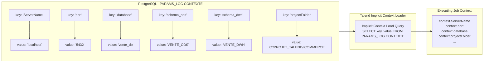

# Parameter and Dynamic Context Configuration Model (PARAMS_LOG)

## Purpose and Scope

The `PARAMS_LOG` schema hosts the central metadata table `CONTEXTE`, providing dynamic externalized configuration for all Talend jobs running across environments.

By using Talend's **Implicit Context Load** feature, jobs query `PARAMS_LOG.CONTEXTE` on launch. Any key stored in the table dynamically overrides job-level default context variables, decoupling runtime environments (development, staging, production) from hardcoded job definitions.



---

## Physical DDL and Table Specification

```sql
CREATE SCHEMA "PARAMS_LOG";

CREATE TABLE "PARAMS_LOG"."CONTEXTE"
(
    key   VARCHAR(100) NOT NULL,
    value VARCHAR(255) ,
    CONSTRAINT "CONTEXTE_PKEY" PRIMARY KEY (key)
);
```

### Registered Configuration Keys

| Key Name | Sample Value | Description |
| :--- | :--- | :--- |
| `ServerName` | `localhost` | Hostname or IP address of the target PostgreSQL database |
| `port` | `5432` | TCP port for PostgreSQL listener |
| `database` | `vente_db` | Database catalog name |
| `utilisateur` | `postgres` | Database operational user account |
| `password` | `******` | Database user password (or vault token) |
| `schema_param` | `PARAMS_LOG` | Schema holding configuration tables |
| `schema_ods` | `VENTE_ODS` | Schema holding staging tables |
| `schema_dwh` | `VENTE_DWH` | Schema holding analytical mart tables |
| `projectFolder` | `C:/PROJET_TALEND/ICOMMERCE/` | Base directory containing ingress date-partitioned folders |
| `encodage` | `UTF-8` | Character encoding for input CSV files |
| `fieldSeparator` | `\|` | Column delimiter character for CSV feeds |

---

## SQL Initialization Script

Reference initialization script: `workspace://codebase/7c8eded6-9911-48de-929c-053e124fc8b5/file/scriptSQL_partie_1/4-script_insert_context_variable.sql`.

```sql
INSERT INTO "PARAMS_LOG"."CONTEXTE" (key, value) VALUES
('ServerName', 'localhost'),
('database', 'vente_db'),
('port', '5432'),
('utilisateur', 'postgres'),
('password', 'your_password'),
('schema_ods', 'VENTE_ODS'),
('schema_dwh', 'VENTE_DWH'),
('projectFolder', 'C:/PROJET_TALEND/ICOMMERCE/csvFiles/');
```

---

## Evidence Grounding

- Table definition DDL: `workspace://codebase/7c8eded6-9911-48de-929c-053e124fc8b5/file/scriptSQL_partie_1/3-script_create_table_params_log.sql`
- Context definition item: `workspace://codebase/7c8eded6-9911-48de-929c-053e124fc8b5/file/ALIMENTATION_DATA_WAREHOUSE/context/projectvariable_0.1.item`
