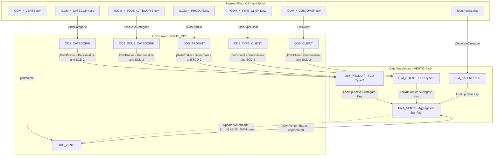

# End-to-End Ingestion to Analytics Data Lineage

## Purpose and Scope

This document tracks the comprehensive data lineage from raw ingress files through the Operational Data Store staging tier to analytical Data Warehouse dimensions and fact tables.

---

## Field-Level Lineage Matrix

### 1. Product Dimension Lineage DIM_PRODUIT

| Target Column (`DIM_PRODUIT`) | ODS Source Table & Column | Ingress File & Column | Transformation / Rule |
| :--- | :--- | :--- | :--- |
| `ID_DIM_PRODUIT` | Auto-sequence | - | PostgreSQL `nextval('DIM_PRODUIT_seq')` |
| `CD_PRODUIT` | `ODS_PRODUIT.CD_PRODUIT` | `ICOM_*_PRODUIT.csv` -> `CD_PRODUIT` | Direct map |
| `NOM_PRODUIT` | `ODS_PRODUIT.NOM_PRODUIT` | `ICOM_*_PRODUIT.csv` -> `NOM_PRODUIT` | Direct map |
| `PRIX_ACHAT_PRODUIT` | `ODS_PRODUIT.PRIX_ACHAT_PRODUIT`| `ICOM_*_PRODUIT.csv` -> `PRIX_ACHAT_PRODUIT` | Direct map (BigDecimal) |
| `PRIX_VENTE_PRODUIT` | `ODS_PRODUIT.PRIX_VENTE_PRODUIT`| `ICOM_*_PRODUIT.csv` -> `PRIX_VENTE_PRODUIT` | Direct map (BigDecimal) |
| `CD_SOUS_CATEGORIE` | `ODS_PRODUIT.CD_SOUS_CATEGORIE` | `ICOM_*_PRODUIT.csv` -> `CD_SOUS_CATEGORIE`| Direct map |
| `LB_SOUS_CATEGORIE` | `ODS_SOUS_CATEGORIE.LB_SOUS_CATEGORIE`| `ICOM_*_SOUS_CATEGORIE.csv` -> `LB_SOUS_CATEGORIE` | Lookup join on `CD_SOUS_CATEGORIE` |
| `CD_CATEGORIE` | `ODS_SOUS_CATEGORIE.CD_CATEGORIE` | `ICOM_*_SOUS_CATEGORIE.csv` -> `CD_CATEGORIE` | Direct map from sub-category lookup |
| `LB_CATEGORIE` | `ODS_CATEGORIE.LB_CATEGORIE` | `ICOM_*_CATEGORY.csv` -> `LB_CATEGORIE` | Lookup join on `CD_CATEGORIE` |
| `BL_LIGNE_ACTIVE` | Managed | - | `1` on insertion, `0` when superseded |
| `DT_INSERTION` | Managed | - | Current timestamp at insert |
| `DT_MISE_A_JOUR` | Managed | - | `null` on insert, timestamp when updated |

---

### 2. Customer Dimension Lineage DIM_CLIENT

| Target Column (`DIM_CLIENT`) | ODS Source Table & Column | Ingress File & Column | Transformation / Rule |
| :--- | :--- | :--- | :--- |
| `ID_DIM_CLIENT` | Auto-sequence | - | PostgreSQL `nextval('DIM_CLIENT_seq')` |
| `ID_CLIENT` | `ODS_CLIENT.ID_CLIENT` | `ICOM_*_CUSTOMER.csv` -> `ID_CLIENT` | Direct map |
| `NOM_CLIENT` | `ODS_CLIENT.NOM_CLIENT` | `ICOM_*_CUSTOMER.csv` -> `NOM_CLIENT` | Direct map |
| `PREN_CLIENT` | `ODS_CLIENT.PREN_CLIENT` | `ICOM_*_CUSTOMER.csv` -> `PREN_CLIENT` | Direct map |
| `CD_POSTAL_CLIENT` | `ODS_CLIENT.CD_POSTAL_CLIENT` | `ICOM_*_CUSTOMER.csv` -> `CD_POSTAL_CLIENT`| Direct map |
| `VILLE_CLIENT` | `ODS_CLIENT.VILLE_CLIENT` | `ICOM_*_CUSTOMER.csv` -> `VILLE_CLIENT` | Direct map |
| `PAYS_CLIENT` | `ODS_CLIENT.PAYS_CLIENT` | `ICOM_*_CUSTOMER.csv` -> `PAYS_CLIENT` | Direct map |
| `REGION_CLIENT` | `ODS_CLIENT.REGION_CLIENT` | `ICOM_*_CUSTOMER.csv` -> `REGION_CLIENT` | Direct map |
| `CD_TYPE_CLIENT` | `ODS_CLIENT.CD_TYPE_CLIENT` | `ICOM_*_CUSTOMER.csv` -> `CD_TYPE_CLIENT`| Direct map |
| `LB_TYPE_CLIENT` | `ODS_TYPE_CLIENT.LB_TYPE_CLIENT`| `ICOM_*_TYPE_CLIENT.csv` -> `LB_TYPE_CLIENT` | Lookup join on `CD_TYPE_CLIENT` |

---

### 3. Sales Fact Lineage FAIT_VENTE

| Target Column (`FAIT_VENTE`) | Source Stream / Dimension | Transformation Formula |
| :--- | :--- | :--- |
| `ID_FAIT_VENTE` | Auto-sequence | PostgreSQL serial sequence |
| `ID_DIM_PRODUIT` | `DIM_PRODUIT.ID_DIM_PRODUIT` | Lookup on `ODS_VENTE.CD_PRODUIT = DIM_PRODUIT.CD_PRODUIT` where active |
| `ID_DIM_CLIENT` | `DIM_CLIENT.ID_DIM_CLIENT` | Lookup on `ODS_VENTE.ID_CLIENT = DIM_CLIENT.ID_CLIENT` where active |
| `ID_DIM_CALENDRIER`| `DIM_CALENDRIER.ID_DIM_CALENDRIER` | Lookup on `ODS_VENTE.DT_VENTE = DIM_CALENDRIER.DT_JOUR` |
| `NB_VENTE` | `ODS_VENTE.ID_VENTE` | `count(ID_VENTE)` in `tAggregateRow` |
| `NB_QTE_VENTE` | `ODS_VENTE.QTE_VENTE` | `count` / `sum` across grouped transactions |
| `NB_MT_ACHAT` | `ODS_VENTE` | `sum(QTE_VENTE * PRIX_ACHAT)` |
| `NB_MT_VENTE` | `ODS_VENTE` | `sum(QTE_VENTE * PRIX_VENTE)` |

---

## Evidence Grounding

- `jDwhVente` mapper: `workspace://codebase/7c8eded6-9911-48de-929c-053e124fc8b5/file/ALIMENTATION_DATA_WAREHOUSE/process/DWH/jDwhVente_0.1.item` (lines 330-435)
- `jDwhProduit` mapper: `workspace://codebase/7c8eded6-9911-48de-929c-053e124fc8b5/file/ALIMENTATION_DATA_WAREHOUSE/process/DWH/jDwhProduit_0.1.item`
- SQL validation queries: `workspace://codebase/7c8eded6-9911-48de-929c-053e124fc8b5/file/scriptSQL_partie_2/5-script_select_table_dwh.sql`
