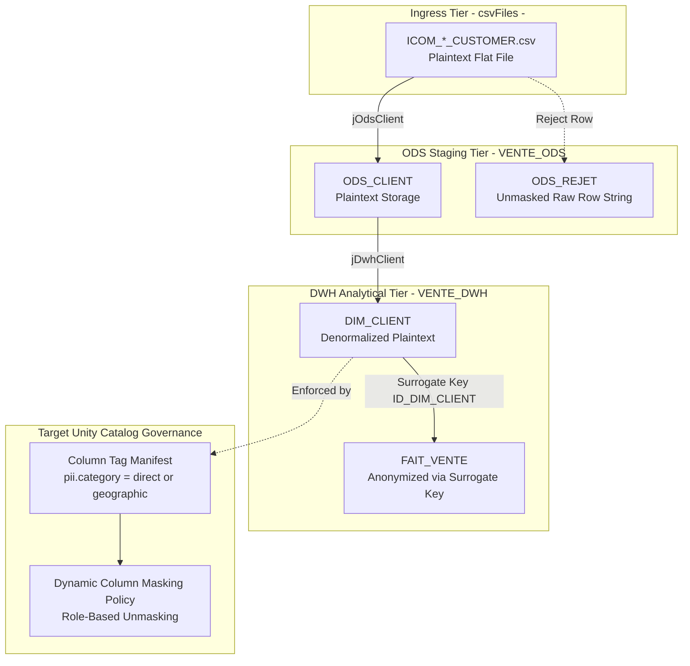
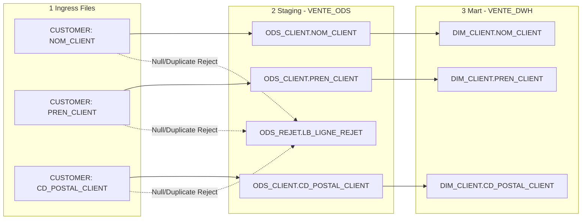

# PII Classification, Sensitive Lineage, and Governance Specification

## Purpose and Scope

This document establishes the **Personally Identifiable Information (PII) classification matrix**, sensitive data lineage, and privacy governance requirements across the **Talend Data Warehouse Alimentation** system, following the `talend-data-lineage` and `talend-tmap-analysis` modernization specifications.

It tracks sensitive customer fields from raw ingress flat files through operational staging and dimensional warehousing to analytical consumption, identifying legacy protection gaps and prescribing target **Unity Catalog Attribute-Based Access Control (ABAC)** and dynamic column masking policies.



---

## PII Entity and Attribute Classification Matrix

The customer domain (`ICOM_*_CUSTOMER.csv` $\rightarrow$ `ODS_CLIENT` $\rightarrow$ `DIM_CLIENT`) contains candidate sensitive attributes classified according to standard data protection regulations (GDPR / CCPA / HIPAA):

| Field Name | Target Column | PII Classification Category | Sensitivity Level | Description / Data Type | Legacy Storage State |
| :--- | :--- | :--- | :--- | :--- | :--- |
| `ID_CLIENT` | `id_client` | Unique Identifier / Pseudonym | Medium | Natural customer business key (`VARCHAR(50)`) | Plaintext |
| `NOM_CLIENT` | `nom_client` | Direct PII | High | Customer surname (`VARCHAR(100)`) | Plaintext |
| `PREN_CLIENT` | `pren_client` | Direct PII | High | Customer given first name (`VARCHAR(100)`) | Plaintext |
| `CD_POSTAL_CLIENT` | `cd_postal_client` | Quasi-Identifier / Geographic PII | Medium | Postal / Zip code (`VARCHAR(100)`) | Plaintext |
| `VILLE_CLIENT` | `ville_client` | Geographic Attribute | Low | City name (`VARCHAR(100)`) | Plaintext |
| `PAYS_CLIENT` | `pays_client` | Geographic Attribute | Low | Country name (`VARCHAR(100)`) | Plaintext |
| `REGION_CLIENT` | `region_client` | Geographic Attribute | Low | Administrative region / territory | Plaintext |

---

## Sensitive Field Lineage Through Pipeline Tiers



### Analysis of Legacy Protection State
1. **Zero Storage Protection:** The legacy Talend project contains no `tDataMasking` components, no routine-level encryption, and no tokenization. All customer names and addresses are written directly to PostgreSQL disk in cleartext.
2. **Quarantine Leakage Risk:** In `jOdsClient`, when a row fails validation, `tMap_3` concatenates all columns into `LB_LIGNE_REJET` (`row5.ID_CLIENT + '|' + row5.NOM_CLIENT + ...`) and stores it unencrypted in `ODS_REJET`. Support teams inspecting error logs can view raw PII.
3. **Fact Table Isolation:** In `jDwhVente`, `FAIT_VENTE` does not store direct customer names; it links exclusively via integer surrogate key `ID_DIM_CLIENT`. Analytical queries on `FAIT_VENTE` alone do not expose direct PII unless joined back to `DIM_CLIENT`.

---

## Modernized Target Governance: Unity Catalog ABAC & Masking

In the modernized Databricks Lakehouse, PII protection is enforced at the catalog layer without breaking downstream aggregation or ETL pipelines:

### 1. Unity Catalog Column Tagging
Sensitive columns in `silver.dim_client` are assigned governed tags:
```sql
ALTER TABLE vente_catalog.silver.dim_client 
ALTER COLUMN nom_client SET TAGS ('pii.category' = 'direct_pii', 'pii.sensitivity' = 'high');

ALTER TABLE vente_catalog.silver.dim_client 
ALTER COLUMN pren_client SET TAGS ('pii.category' = 'direct_pii', 'pii.sensitivity' = 'high');

ALTER TABLE vente_catalog.silver.dim_client 
ALTER COLUMN cd_postal_client SET TAGS ('pii.category' = 'geographic_pii', 'pii.sensitivity' = 'medium');
```

### 2. Dynamic Masking UDFs and Policy Binding
Create type-compatible SQL masking UDFs that redact data for general analytical consumers while exposing cleartext to authorized compliance personas:

```sql
CREATE OR REPLACE FUNCTION vente_catalog.silver.mask_surname(val STRING)
RETURN CASE 
  WHEN is_account_group_member('compliance_officers') THEN val
  WHEN val IS NULL THEN NULL
  ELSE concat(substring(val, 1, 1), '***')
END;

CREATE OR REPLACE FUNCTION vente_catalog.silver.mask_postal_code(val STRING)
RETURN CASE 
  WHEN is_account_group_member('compliance_officers') THEN val
  WHEN val IS NULL THEN NULL
  ELSE concat(substring(val, 1, 2), '***')
END;

ALTER TABLE vente_catalog.silver.dim_client 
ALTER COLUMN nom_client SET MASK vente_catalog.silver.mask_surname;

ALTER TABLE vente_catalog.silver.dim_client 
ALTER COLUMN cd_postal_client SET MASK vente_catalog.silver.mask_postal_code;
```

### 3. Role-Based Access Results
- **Standard BI Consumers & Analysts:** Querying `SELECT nom_client, cd_postal_client FROM dim_client` sees `D***` and `75***`.
- **Compliance & Privacy Officers:** View exact values (`Dupont`, `75001`).
- **ETL Service Principals:** Granted pipeline-level unmask access to ensure SCD Type 2 change-detection hashing evaluates true cleartext attributes.

---

## Evidence Grounding

- Customer ingestion job: `workspace://codebase/7c8eded6-9911-48de-929c-053e124fc8b5/file/ALIMENTATION_DATA_WAREHOUSE/process/ODS/jOdsClient_0.1.item`
- Customer DWH job: `workspace://codebase/7c8eded6-9911-48de-929c-053e124fc8b5/file/ALIMENTATION_DATA_WAREHOUSE/process/DWH/jDwhClient_0.1.item`
- ODS DDL: `workspace://codebase/7c8eded6-9911-48de-929c-053e124fc8b5/file/scriptSQL_partie_1/2-script_create_table_ods.sql` (lines 77-91)
- DWH DDL: `workspace://codebase/7c8eded6-9911-48de-929c-053e124fc8b5/file/scriptSQL_partie_2/2-script_create_table_dwh.sql` (lines 38-56)
