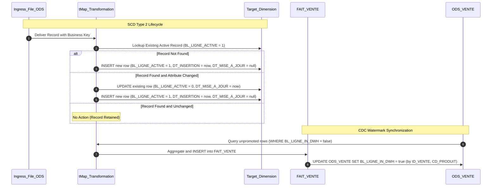

# Slowly Changing Dimensions and CDC Watermarking Mechanics

## Purpose and Scope

This document details the dual synchronization mechanisms that preserve data history and ensure idempotent, restartable batch executions across the Talend pipeline:
1. **Slowly Changing Dimension Type 2 (SCD-2)** implemented at both the ODS and DWH tiers.
2. **Change Data Capture (CDC) / Watermarking** using `BL_LIGNE_IN_DWH` in `ODS_VENTE`.



---

## 1. SCD Type 2 Mechanics

The system maintains historical fidelity through an explicit three-attribute tracking convention:

| Attribute | Data Type | Meaning | Transition Rule |
| :--- | :--- | :--- | :--- |
| `BL_LIGNE_ACTIVE` | `INTEGER` | Active version flag | Set to `1` upon creation; flipped to `0` when a newer version arrives |
| `DT_INSERTION` | `TIMESTAMP` | Record validity start | Stamped with `TalendDate.getCurrentDate()` on initial insertion |
| `DT_MISE_A_JOUR` | `TIMESTAMP` | Record validity end | Null while record is active; stamped with current timestamp when updated to historical |

### Querying Dimension State
- **Current Dimension View:**
  ```sql
  SELECT * FROM "VENTE_DWH"."DIM_PRODUIT" WHERE "BL_LIGNE_ACTIVE" = 1;
  ```
- **Historical Point-in-Time View:**
  ```sql
  SELECT * FROM "VENTE_DWH"."DIM_PRODUIT"
  WHERE "DT_INSERTION" <= :target_timestamp 
    AND ("DT_MISE_A_JOUR" > :target_timestamp OR "DT_MISE_A_JOUR" IS NULL);
  ```

---

## 2. CDC Watermark Mechanics in Sales Pipeline

Rather than relying on file deletion or destructive truncation of the ODS layer, `ODS_VENTE` tracks incremental propagation status via `BL_LIGNE_IN_DWH`:

1. **Initial Staging:** `jOdsVente` inserts records with `BL_LIGNE_IN_DWH = false`.
2. **Incremental Extraction:** `jDwhVente` queries exclusively with:
   ```sql
   SELECT ... FROM "VENTE_ODS"."ODS_VENTE" WHERE "BL_LIGNE_IN_DWH" = False;
   ```
3. **In-Memory Holding:** Extracted records are held in memory (`tHashOutput_1`) while fact calculations and aggregation are performed.
4. **Watermark Promotion:** After successful insertion of fact records into `FAIT_VENTE`, the job issues an update back to `ODS_VENTE`:
   ```sql
   UPDATE "VENTE_ODS"."ODS_VENTE" 
   SET "BL_LIGNE_IN_DWH" = true 
   WHERE "ID_VENTE" = ? AND "CD_PRODUIT" = ?;
   ```
5. **Transactional Consistency:** Both the fact table insert and ODS watermark update are committed together in `tPostjob` (`tDBCommit_1` and `tDBCommit_2`). If a failure occurs before commit, the database transactions roll back, leaving `BL_LIGNE_IN_DWH = false`, allowing safe rerun.

---

## Evidence Grounding

- Fact loading item: `workspace://codebase/7c8eded6-9911-48de-929c-053e124fc8b5/file/ALIMENTATION_DATA_WAREHOUSE/process/DWH/jDwhVente_0.1.item`
- Dimension loading items: `jDwhProduit_0.1.item` and `jDwhClient_0.1.item`
