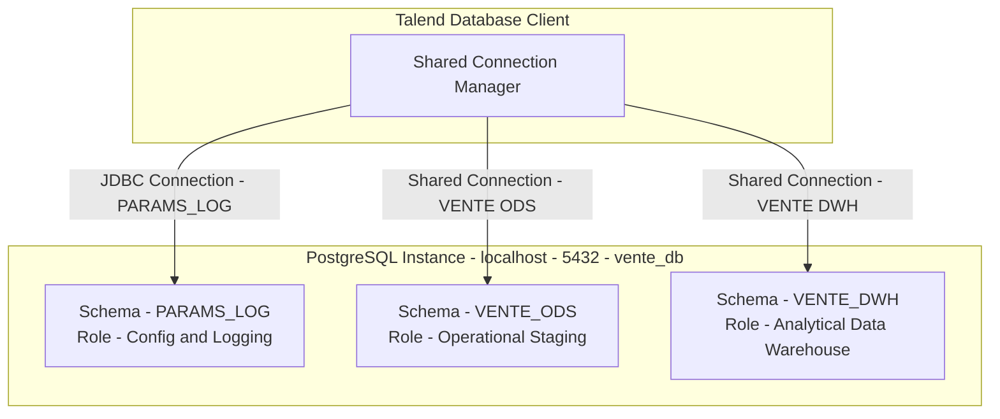

# PostgreSQL Storage and Database Interface Contracts

## Purpose and Scope

The system interfaces with three distinct schema domains residing within a single PostgreSQL database instance (`vente_db`). This document specifies the connection definitions, JDBC parameters, access roles, and isolation semantics.

---

## Connection Specifications

| Metadata Connection ID | Logical Name | PostgreSQL Schema | Shared Connection Key | Default User |
| :--- | :--- | :--- | :--- | :--- |
| `_xUKdAD-rEfCJkrHegI1I0A` | `PARAMS_LOG` | `PARAMS_LOG` | Unpooled (Direct) | `postgres` |
| `_MQSMkD-pEfCJkrHegI1I0A` | `VENTE_ODS` | `VENTE_ODS` | `"VENTE ODS"` | `postgres` |
| `_FKqAwEHlEfCRobsmOeibog` | `VENTE_DWH` | `VENTE_DWH` | `"VENTE DWH"` | `postgres` |

---

## Technical Connection Parameters

- **Database Engine:** PostgreSQL
- **JDBC Driver Class:** `org.postgresql.Driver`
- **Driver Library:** `postgresql-42.2.14.jar`
- **JDBC URL Format:** `jdbc:postgresql://<ServerName>:<port>/<database>?<additionalParam>`
- **Character Encoding:** `ISO-8859-15` (enforced at JDBC layer)
- **Auto-Commit Behavior:** `AUTO_COMMIT = false` on shared connections. Commits are explicitly managed via `tPostgresqlCommit` components during postjob execution phases.
- **Batch Processing:** Bulk inserts and updates utilize `USE_BATCH_SIZE = true` with a batch threshold of `10,000` records.

---

## Database User Permissions and Security Requirements

The database execution account requires:
1. `USAGE` and `CREATE` privileges on schemas `PARAMS_LOG`, `VENTE_ODS`, and `VENTE_DWH`.
2. `SELECT` on `PARAMS_LOG.CONTEXTE`.
3. `SELECT`, `INSERT`, `UPDATE`, `DELETE` on all tables in `VENTE_ODS`.
4. `SELECT`, `INSERT`, `UPDATE` on all tables in `VENTE_DWH`.
5. `USAGE, SELECT` on PostgreSQL sequences:
   - `VENTE_DWH.DIM_PRODUIT_ID_DIM_PRODUIT_seq`
   - `VENTE_DWH.DIM_CLIENT_ID_DIM_CLIENT_seq`
   - `VENTE_DWH.FAIT_VENTE_ID_FAIT_VENTE_seq`

---

## Evidence Grounding

- Repository connection metadata: `workspace://codebase/7c8eded6-9911-48de-929c-053e124fc8b5/file/ALIMENTATION_DATA_WAREHOUSE/metadata/connections/`
- SQL Setup scripts: `workspace://codebase/7c8eded6-9911-48de-929c-053e124fc8b5/file/scriptSQL_partie_1/1-script_create_schema.sql` and `scriptSQL_partie_2/1-script_create_schema_dwh.sql`
