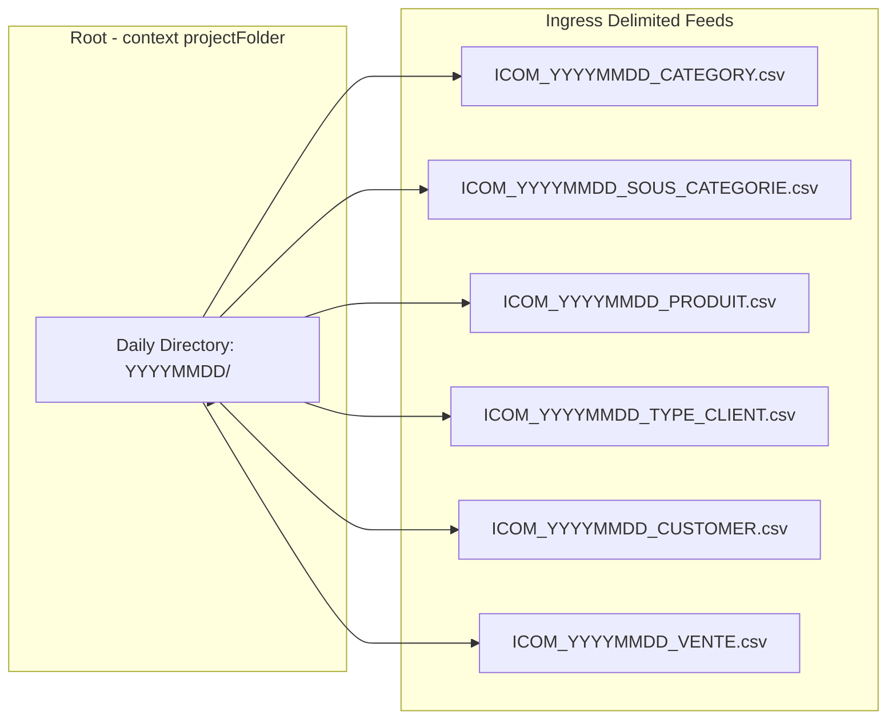

# File Ingress Specifications and Delimited Record Contracts

## Purpose and Scope

This document specifies the technical interface contracts for all external files consumed by the ingestion pipeline. Upstream commercial applications deliver text feeds adhering to strict naming conventions, line terminators, encodings, and column layouts.

---

## Global File Transport and Format Standards

- **Directory Hierarchy:** `{projectFolder}/{YYYYMMDD}/`
- **File Format:** Delimited text flat files (CSV).
- **Header Line:** Exactly 1 header row present in every file (`HEADER = 1`).
- **Footer Line:** None (`FOOTER = 0`).
- **Row Delimiter:** Unix newline (`\n`).
- **Field Delimiter:** Pipe character (`|`) configured via `context.fieldSeparator`.
- **Text Qualifier / Escape:** Double quotes (`"`), `CSV_OPTION = false`.
- **Character Encoding:** Custom configured via `context.encodage` (`UTF-8` or `ISO-8859-15`).
- **Empty Rows:** Dropped automatically (`REMOVE_EMPTY_ROW = true`).

---

## Specific File Ingress Layouts

### 1. Layout ICOM_YYYYMMDD_CATEGORY.csv
- **Filename Mask:** `ICOM_*_CATEGORY.csv`
- **Schema Layout:**
  1. `CD_CATEGORIE`: String, mandatory, max 50 chars.
  2. `LB_CATEGORIE`: String, mandatory, max 100 chars.

### 2. Layout ICOM_YYYYMMDD_SOUS_CATEGORIE.csv
- **Filename Mask:** `ICOM_*_SOUS_CATEGORIE.csv`
- **Schema Layout:**
  1. `CD_SOUS_CATEGORIE`: String, mandatory, max 50 chars.
  2. `LB_SOUS_CATEGORIE`: String, mandatory, max 100 chars.
  3. `CD_CATEGORIE`: String, mandatory, foreign reference to category.

### 3. Layout ICOM_YYYYMMDD_PRODUIT.csv
- **Filename Mask:** `ICOM_*_PRODUIT.csv`
- **Schema Layout:**
  1. `CD_PRODUIT`: String, mandatory, max 50 chars.
  2. `NOM_PRODUIT`: String, mandatory, max 255 chars.
  3. `PRIX_ACHAT_PRODUIT`: Numeric / Decimal string, mandatory.
  4. `PRIX_VENTE_PRODUIT`: Numeric / Decimal string, mandatory.
  5. `CD_SOUS_CATEGORIE`: String, mandatory, foreign reference.

### 4. Layout ICOM_YYYYMMDD_TYPE_CLIENT.csv
- **Filename Mask:** `ICOM_*_TYPE_CLIENT.csv`
- **Schema Layout:**
  1. `CD_TYPE_CLIENT`: String, mandatory, max 50 chars.
  2. `LB_TYPE_CLIENT`: String, mandatory, max 100 chars.

### 5. Layout ICOM_YYYYMMDD_CUSTOMER.csv
- **Filename Mask:** `ICOM_*_CUSTOMER.csv`
- **Schema Layout:**
  1. `ID_CLIENT`: String, mandatory, max 50 chars.
  2. `NOM_CLIENT`: String, mandatory, max 100 chars.
  3. `PREN_CLIENT`: String, mandatory, max 100 chars.
  4. `CD_POSTAL_CLIENT`: String, optional, max 100 chars.
  5. `VILLE_CLIENT`: String, mandatory, max 100 chars.
  6. `PAYS_CLIENT`: String, mandatory, max 100 chars.
  7. `REGION_CLIENT`: String, mandatory, max 100 chars.
  8. `CD_TYPE_CLIENT`: String, mandatory, foreign reference.

### 6. Layout ICOM_YYYYMMDD_VENTE.csv
- **Filename Mask:** `ICOM_*_VENTE.csv`
- **Schema Layout:**
  1. `ID_VENTE`: String, mandatory, max 50 chars.
  2. `CD_PRODUIT`: String, mandatory, max 50 chars.
  3. `DT_VENTE`: Date string, pattern `dd-MM-yyyy` (or timestamp).
  4. `ID_CLIENT`: String, mandatory, max 50 chars.
  5. `QTE_VENTE`: Integer string, mandatory.
  6. `PRIX_ACHAT`: Numeric string, mandatory.
  7. `PRIX_VENTE`: Numeric string, mandatory.

---

## Holiday Reference File joursFeries.xlsx

- **Format:** Microsoft Excel (`.xlsx`), read via Apache POI.
- **Location:** Project root or working execution directory.
- **Columns:** `Date` (`Date`), `NomFerie` (`String`).

---

## Evidence Grounding

- Sample CSV files: `workspace://codebase/7c8eded6-9911-48de-929c-053e124fc8b5/file/csvFiles/`
- Generic schema metadata: `workspace://codebase/7c8eded6-9911-48de-929c-053e124fc8b5/file/ALIMENTATION_DATA_WAREHOUSE/metadata/genericSchema/`
