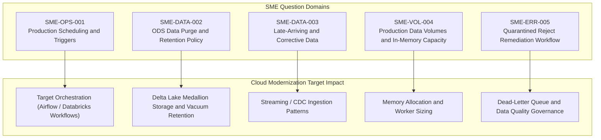

# Modernization Gap Analysis and SME Backlog

## Purpose and Scope

This document details technical ambiguities, unevidenced operational parameters, and architectural questions that cannot be conclusively answered from codebase inspection alone. These items form a structured SME (Subject Matter Expert) interview backlog for upcoming modernization and cloud migration initiatives.

---

## Technical Unknowns and SME Backlog

| Item ID | Category | Technical Ambiguity Observed in Codebase | Modernization Risk / Impact | Proposed SME Question |
| :--- | :--- | :--- | :--- | :--- |
| **SME-OPS-001** | Orchestration & Scheduling | The repository includes only design-time `.item` files without TAC/TMC export descriptors, crontab, or scheduler scripts. | Deployment requires knowing actual production batch windows, SLA cut-off times, and retry policies. | *What scheduler (e.g. TAC, Autosys, Control-M, Airflow, cron) currently executes `jAlimentationBDD`, and at what time/frequency does it run?* |
| **SME-DATA-002** | Data Retention & Purge | ODS tables grow continuously. Truncate scripts exist (`6-script_truncate_table_ods.sql`), but no scheduled deletion or archival job is present in the Talend project. | Long-term unbounded growth will degrade lookup performance during SCD-2 scans. | *Are ODS tables truncated periodically, or is data archived to cold storage after warehouse promotion?* |
| **SME-DATA-003** | Late-Arriving Dimensions | Sales fact generation performs an inner join (`innerJoin="true"`) against `DIM_PRODUIT` and `DIM_CLIENT`. Unmatched records are silently excluded from `FAIT_VENTE`. | Potential revenue loss in analytics if a transaction references an un-staged customer or product code. | *How should late-arriving dimensions be handled? Should a dummy "Unknown" record be assigned, or should orphaned transactions be quarantined in an error table?* |
| **SME-VOL-004** | In-Memory Scaling | `jDwhVente` uses `tHashOutput` with `MEMORY_HEAP_MAX_SIZE = 2` (GB) and `ROWS_BUFFER_SIZE = 2000000`. | A sudden surge in transaction volume could trigger JVM OutOfMemoryError in a containerized runner. | *What are the average and peak daily row counts for sales transactions (`ICOM_*_VENTE.csv`), and what is the expected year-over-year data growth?* |
| **SME-ERR-005** | Reject Remediation | Rows violating null checks or uniqueness are inserted into `ODS_REJET`, but no downstream process re-evaluates corrected records. | Reject data accumulates without automated recycling or notification alerts to upstream data owners. | *Who monitors `ODS_REJET`, and what operational workflow is followed when source feed data is corrected and re-submitted?* |
| **SME-CAL-006** | Calendar Dimension Scope | `jGenerateCalendar` is hardcoded to end on `2025-12-31`. | Transactions occurring in 2026 or later will fail inner joins against `DIM_CALENDRIER`, preventing fact table ingestion. | *When and how is `DIM_CALENDRIER` extended beyond 2025? Is there an updated holiday calendar file planned for future years?* |

---

## Evidence Grounding

- Standalone truncate script: `workspace://codebase/7c8eded6-9911-48de-929c-053e124fc8b5/file/scriptSQL_partie_1/6-script_truncate_table_ods.sql`
- Memory settings: `workspace://codebase/7c8eded6-9911-48de-929c-053e124fc8b5/file/ALIMENTATION_DATA_WAREHOUSE/process/DWH/jDwhVente_0.1.item` (line 780)
- Calendar limits: `workspace://codebase/7c8eded6-9911-48de-929c-053e124fc8b5/file/ALIMENTATION_DATA_WAREHOUSE/process/DWH/jGenerateCalendar_0.2.item` (line 5)
