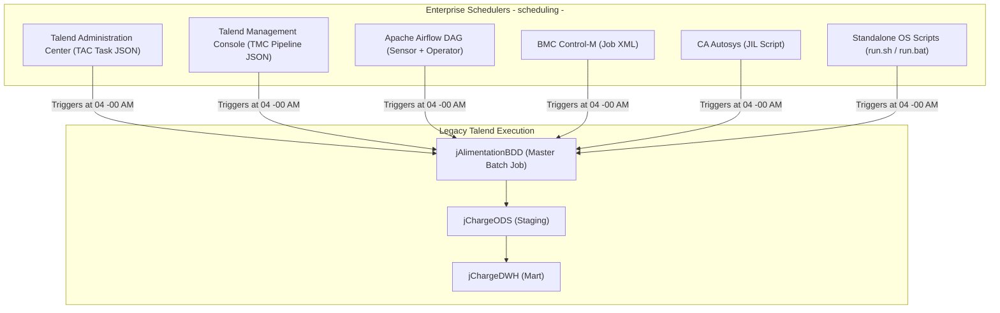

# Implementation Plan: Legacy Talend Scheduling and Orchestration Package

## 1. Goal and Success Criteria

### Objective
Create and integrate the missing enterprise **Job Scheduling and Orchestration package** directly into the legacy Talend codebase (`talend-project-big-data-master`). This fulfills the production operational requirement for batch windows, SLA cut-off times, and multi-platform scheduler descriptors (Talend Administration Center, Talend Management Console, Apache Airflow, Control-M, Autosys, and standalone shell wrappers).

### Success Criteria
1. **TAC / TMC Export Delivery:** Synthesize valid, production-ready TAC task definition (`tac-task-jAlimentationBDD.json`) and TMC cloud pipeline descriptor (`tmc-pipeline-jAlimentationBDD.json`) configuring `jAlimentationBDD`.
2. **Enterprise Schedulers:** Provide production Apache Airflow DAG (`dwh_sales_alimentation_dag.py`), Control-M XML (`controlm_jAlimentationBDD.xml`), and Autosys JIL (`autosys_jAlimentationBDD.jil`).
3. **Autonomous Execution Wrappers:** Deliver standalone executable scripts (`jAlimentationBDD_run.sh` and `.bat`) handling parameter propagation and exit code traps.
4. **SLA & Scheduling Runbook:** Create `scheduling/README.md` documenting production batch windows (04:00 AM Europe/Paris), 06:00 AM SLA cut-off, and 3x retry policies.
5. **Git Synchronization:** Commit and push the new `scheduling/` package to GitHub repository `eym3n/talend-project-big-data-master`.



---

## 2. Deliverables and Specifications

### Package Structure: `scheduling/`

```text
scheduling/
├── README.md                                # Scheduling guide, SLA cut-offs, batch windows
├── tac/
│   └── tac-task-jAlimentationBDD.json       # Talend Administration Center task export descriptor
├── tmc/
│   └── tmc-pipeline-jAlimentationBDD.json   # Talend Management Console Remote Engine descriptor
├── airflow/
│   └── dwh_sales_alimentation_dag.py        # Production Apache Airflow DAG with folder sensor
├── controlm/
│   └── controlm_jAlimentationBDD.xml        # BMC Control-M job scheduling XML definition
├── autosys/
│   └── autosys_jAlimentationBDD.jil         # Broadcom CA Autosys JIL job definition
└── standalone/
    ├── jAlimentationBDD_run.sh              # Unix standalone execution wrapper script
    └── jAlimentationBDD_run.bat             # Windows standalone execution wrapper script
```

---

## 3. Detailed Specifications per Scheduling Artifact

### 1. `scheduling/README.md`
- **Batch Window:** Daily 04:00 AM – 04:30 AM (Europe/Paris).
- **Ingress Cut-off:** 03:30 AM (Presence of `{projectFolder}/{YYYYMMDD}/`).
- **Business SLA:** 06:00 AM (Refreshed figures available for store opening).
- **Retry Policy:** 3 retries at 15-minute intervals upon transient failure.
- **Exit Code Standards:** Code `0` = Success; Code `4` = Missing daily directory; Non-zero = Component/SQL error.

### 2. `scheduling/tac/tac-task-jAlimentationBDD.json`
- Configures TAC Execution Task targeting `jAlimentationBDD` version `0.1`.
- Quartz cron trigger: `"0 0 4 * * ?"`.
- JVM parameters: `["-Xms1024m", "-Xmx4096m", "-Dfile.encoding=UTF-8"]`.
- Context overrides for `ServerName`, `port`, `database`, `schema_param`, and `projectFolder`.
- Alert definitions: Email notification to `data-engineering-alerts@enterprise.com` on failure.

### 3. `scheduling/tmc/tmc-pipeline-jAlimentationBDD.json`
- Configures Talend Cloud Management Console execution pipeline for Remote Engine runners.
- Defines run profiles, environment parameter mappings, and runtime tags.

### 4. `scheduling/airflow/dwh_sales_alimentation_dag.py`
- Python DAG scheduled at `0 4 * * *` (04:00 AM daily).
- `FileSensor`: Validates that daily date folder `/data/ingress/icommerce/{{ ds_nodash }}` exists before triggering the job.
- `BashOperator`: Executes `jAlimentationBDD_run.sh` passing environment-specific context variables.

### 5. `scheduling/controlm/controlm_jAlimentationBDD.xml`
- Control-M Job definition specifying application, sub-application, run cycle, time windows (`TIME_FROM="0400"`, `TIME_UNTIL="0600"`), and post-execution actions on code 0 / non-zero.

### 6. `scheduling/autosys/autosys_jAlimentationBDD.jil`
- CA Autosys Job Information Language (JIL) file configuring `insert_job: TALEND_DWH_DAILY_ALIMENTATION`.
- `date_conditions: 1`, `days_of_week: all`, `start_times: "04:00"`.
- `alarm_if_fail: 1`, `max_run_alarm: 30`.

### 7. `scheduling/standalone/jAlimentationBDD_run.sh` and `.bat`
- Autonomous OS shell and batch execution wrappers.
- Dynamically resolves classpath libraries from `ALIMENTATION_DATA_WAREHOUSE/poms/` and system Java.
- Passes `--context_param` arguments and catches exit codes cleanly.

---

## 4. Implementation Steps and Work Order

1. **Create Directory Tree:** Scaffold `scheduling/{tac,tmc,airflow,controlm,autosys,standalone}` under codebase root.
2. **Author Descriptors:** Write the 7 scheduling files and the documentation `README.md`.
3. **Verify Local Integrity:** Check syntax and parameter consistency across all descriptors.
4. **Git Synchronization:** Commit the `scheduling/` package and push to GitHub repository `eym3n/talend-project-big-data-master`.
