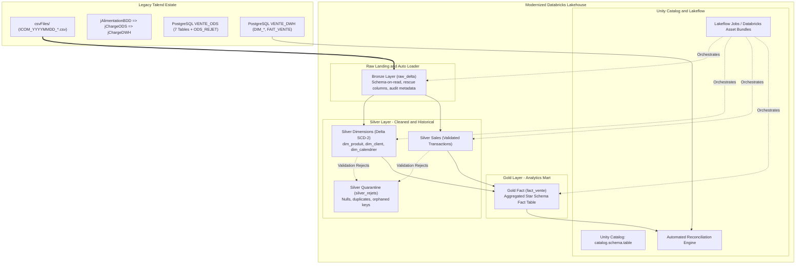

# Talend to Databricks Modernization Implementation Plan

## Executive Summary & Modernization Objective

This work plan outlines the complete modernization of the **Talend Data Warehouse Alimentation** ETL system (`talend-project-big-data-master`) to **Azure Databricks**, **Delta Lake**, and **Unity Catalog**. 

The legacy platform—composed of 10 Talend jobs, 7 ODS PostgreSQL tables, and 4 DWH star schema tables—will be transformed into a cloud-native, configuration-driven **Medallion Lakehouse architecture** (Bronze, Silver, Gold) powered by PySpark and Lakeflow Jobs, preserving 100% of the business logic, rejection quarantine semantics, SCD Type 2 historization, and financial aggregation while eliminating legacy proprietary runtime dependencies.



---

## 1. Architectural Blueprint and Subsystem Design

### Subsystem 1: Unity Catalog Governance and Medallion Storage

The modernized data assets will reside under Unity Catalog using three distinct schemas within a designated catalog (default `vente_catalog` or parameterized):

| Layer | Unity Catalog Schema | Table Name | Storage Format | Partitioning / Liquid Clustering |
| :--- | :--- | :--- | :--- | :--- |
| **Bronze** | `vente_catalog.bronze` | `raw_categories`<br/>`raw_subcategories`<br/>`raw_products`<br/>`raw_customer_types`<br/>`raw_customers`<br/>`raw_sales` | Delta Lake | `_ingest_date` |
| **Silver** | `vente_catalog.silver` | `dim_produit`<br/>`dim_client`<br/>`dim_calendrier`<br/>`stg_sales`<br/>`silver_quarantine_rejets` | Delta Lake | `dim_produit`: `is_active`<br/>`dim_client`: `is_active`<br/>`stg_sales`: `dt_vente` |
| **Gold** | `vente_catalog.gold` | `fact_vente` | Delta Lake | `id_dim_calendrier` |

### Subsystem 2: Bronze Ingestion Engine
- **Component:** `src/bronze/ingest_raw_feeds.py`
- **Pattern:** PySpark structured batch ingestion with schema preservation.
- **Ingress Path:** Cloud object storage path (e.g. `/Volumes/vente_catalog/bronze/raw_landing/{YYYYMMDD}/`).
- **Enrichment:** Adds ingestion lineage metadata columns:
  - `_ingest_file_name`: Source file path (`input_file_name()`).
  - `_ingest_timestamp`: Processing UTC timestamp (`current_timestamp()`).
  - `_ingest_date`: Partitioning date key (`YYYYMMDD`).
  - `_job_run_id`: Execution workflow identifier.
- **Error Handling:** Corrupt or malformed records routed to `_rescued_data` column without halting the batch.

### Subsystem 3: Silver Normalization, Quality Rules, and SCD-2 Engine
- **Component:** `src/silver/scd2_dimension_merge.py` and `src/silver/clean_reference_data.py`
- **Validation Rules (`BR-VAL-*`):**
  - Evaluates mandatory non-null attributes using PySpark DataFrame filters or Delta Expectations.
  - Rows failing mandatory field checks are written to `silver_quarantine_rejets` with `rejection_reason = 'Valeurs nulles pour certain colonnes'`.
- **Deduplication Rules (`BR-DEDUP-*`):**
  - Applies `row_number().over(Window.partitionBy(business_keys).orderBy(ingest_timestamp))` to quarantine duplicate lines in `silver_quarantine_rejets` with `rejection_reason = 'Donnees en double'`.
- **SCD Type 2 Historization (`BR-SCD-*`):**
  - Replaces custom Talend tMap logic with an idempotent Delta Lake `MERGE` operation.
  - Compares incoming distinct records against `silver.dim_produit` and `silver.dim_client` where `is_active = 1`.
  - When non-key attributes differ:
    - Sets `is_active = 0` and `dt_mise_a_jour = current_timestamp()` on existing target rows.
    - Inserts new version with `is_active = 1`, `dt_insertion = current_timestamp()`, and `dt_mise_a_jour = null`.
- **Surrogate Keys:** Generated using deterministic hashing (`sha2(concat_ws('||', business_key, string(dt_insertion)), 256)`) or integer identity columns (`GENERATED ALWAYS AS IDENTITY`).

### Subsystem 4: Calendar Dimension Builder
- **Component:** `src/silver/build_calendar_dimension.py`
- Replaces `jGenerateCalendar` and Excel POI dependency.
- Generates dates from `2020-01-01` through `2030-12-31` using PySpark `sequence(to_date('2020-01-01'), to_date('2030-12-31'), interval 1 day)`.
- Calculates calendar attributes (`nb_annee`, `nb_semestre`, `nb_trimestre`, `nb_mois`, `nb_jour_annee`, `nb_jour_semaine`, French labels `lb_mois`, `lb_jour`, `bl_bissextile`, `bl_week_end`, `bl_dernier_jour_mois`).
- Joins with public holiday definitions (supporting embedded French national holiday formulas for Easter, Ascension, Pentecost, and fixed dates, plus optional CSV/Delta reference).

### Subsystem 5: Gold Sales Fact Aggregator
- **Component:** `src/gold/aggregate_sales_fact.py`
- Replaces `jDwhVente`, `tHashOutput`, and `tAggregateRow`.
- Queries clean un-promoted records from `silver.stg_sales`.
- Performs conformed inner joins:
  - `dim_produit` on `cd_produit` where `is_active = 1`.
  - `dim_client` on `id_client` where `is_active = 1`.
  - `dim_calendrier` on `to_date(dt_vente) = dt_jour`.
- Evaluates metrics:
  - `mt_achat = qte_vente * prix_achat`
  - `mt_vente = qte_vente * prix_vente`
- Groups by `(id_dim_produit, id_dim_client, id_dim_calendrier)` and aggregates:
  - `nb_vente = count(id_vente)`
  - `nb_qte_vente = sum(qte_vente)`
  - `nb_mt_achat = sum(mt_achat)`
  - `nb_mt_vente = sum(mt_vente)`
- Inserts into `gold.fact_vente`.
- Atomically updates watermark `bl_ligne_in_dwh = true` in `silver.stg_sales`.

### Subsystem 6: Lakeflow Jobs and Orchestration
- **Component:** `resources/jobs/sales_pipeline_job.yml` (Databricks Asset Bundle definition)
- Replaces `jAlimentationBDD`.
- Sequential Task DAG:
  1. `validate_directory_ingress` -> Checks daily folder presence (raises clean exception if absent).
  2. `bronze_ingestion` -> Ingests all 6 CSV feeds into Bronze Delta tables.
  3. `silver_dimensions` -> Ingests and updates `dim_produit` and `dim_client` via SCD-2 merges.
  4. `silver_sales` -> Validates sales transactions and logs rejections to `silver_quarantine_rejets`.
  5. `gold_fact_sales` -> Aggregates metrics and loads `fact_vente`.
  6. `reconciliation_check` -> Executes automated equivalence validation.

### Subsystem 7: Automated Equivalence and Reconciliation Framework
- **Component:** `tests/equivalence/reconcile_talend_vs_databricks.py`
- Automated post-execution validation comparing output across legacy PostgreSQL and Databricks Delta:
  - Row counts per table.
  - Primary key parity and distinct count matches.
  - Aggregate measure reconciliations: `SUM(nb_mt_achat)`, `SUM(nb_mt_vente)`, `SUM(nb_qte_vente)`, `SUM(nb_vente)`.
  - Reject counts and classification parity against `ODS_REJET`.

---

## 2. Target File and Package Layout

```
databricks/
├── databricks.yml                           # Databricks Asset Bundle configuration
├── README.md                                # Modernized system operations guide
├── config/
│   ├── pipeline_config.yaml                 # Catalog, schema, volume, and file definitions
│   └── quality_rules.yaml                   # Expectation and quarantine thresholds
├── resources/
│   └── jobs/
│       └── sales_pipeline_job.yml           # Lakeflow Multi-task Job orchestration
├── src/
│   ├── common/
│   │   ├── __init__.py
│   │   ├── session.py                       # SparkSession and catalog resolution
│   │   ├── audit.py                         # Execution logging, duration, run stats
│   │   └── holidays.py                      # Public holiday algorithm and calendar utilities
│   ├── bronze/
│   │   ├── __init__.py
│   │   └── ingest_raw_feeds.py              # Ingests CSVs into Bronze Delta tables
│   ├── silver/
│   │   ├── __init__.py
│   │   ├── clean_reference_data.py          # Category, Subcategory, Product, Customer
│   │   ├── scd2_dimension_merge.py          # Reusable Delta Lake SCD-2 MERGE engine
│   │   ├── build_calendar_dimension.py      # Calendar dimension generation
│   │   └── clean_sales_transactions.py      # Sales validation and reject logging
│   └── gold/
│       ├── __init__.py
│       └── aggregate_sales_fact.py          # Gold star schema fact table builder
├── tests/
│   ├── unit/
│   │   ├── test_transformations.py          # PySpark transformation unit tests
│   │   ├── test_scd2_merge.py               # SCD-2 versioning tests
│   │   └── test_calendar_builder.py         # Date dimension formula tests
│   └── equivalence/
│       └── reconcile_talend_vs_databricks.py # Automated reconciliation engine
```

---

## 3. Work Order and Implementation Phases

### Phase 1: Environment, Configuration, and Foundation
- **Step 1.1:** Scaffold target project structure under `databricks/`.
- **Step 1.2:** Implement `config/pipeline_config.yaml` externalizing catalog name, schema names, storage volume locations, and file masks.
- **Step 1.3:** Implement `src/common/session.py` and `src/common/audit.py` for structured execution logging and runtime metrics.

### Phase 2: Bronze Ingestion Layer
- **Step 2.1:** Implement `src/bronze/ingest_raw_feeds.py` supporting pipe-delimited CSV extraction, header handling, encoding resolution, and lineage metadata stamping.
- **Step 2.2:** Verify Bronze table creation (`raw_categories`, `raw_subcategories`, `raw_products`, `raw_customer_types`, `raw_customers`, `raw_sales`).

### Phase 3: Silver Layer, Quality Rules, and SCD-2
- **Step 3.1:** Implement quarantine logging in `src/silver/clean_reference_data.py` writing invalid rows and duplicates to `silver_quarantine_rejets`.
- **Step 3.2:** Implement generic Delta SCD-2 MERGE logic in `src/silver/scd2_dimension_merge.py` supporting `dim_produit` and `dim_client`.
- **Step 3.3:** Implement calendar dimension generator in `src/silver/build_calendar_dimension.py` spanning 2020–2030 with holiday calculations.
- **Step 3.4:** Implement `src/silver/clean_sales_transactions.py` with validation and staging in `stg_sales`.

### Phase 4: Gold Dimensional Fact Mart
- **Step 4.1:** Implement `src/gold/aggregate_sales_fact.py` joining `stg_sales` with active dimensions and computing aggregated financial measures.
- **Step 4.2:** Implement atomic watermark flag update (`bl_ligne_in_dwh = true`) in `silver.stg_sales`.

### Phase 5: Orchestration and Databricks Asset Bundle
- **Step 5.1:** Author `databricks.yml` and `resources/jobs/sales_pipeline_job.yml` wiring the multi-task Lakeflow DAG.
- **Step 5.2:** Add pre-run validation task verifying that daily directory exists before downstream task execution.

### Phase 6: Equivalence Testing and Verification
- **Step 6.1:** Author unit tests in `tests/unit/test_transformations.py` and `test_scd2_merge.py`.
- **Step 6.2:** Author reconciliation script `tests/equivalence/reconcile_talend_vs_databricks.py` verifying row counts, surrogate key linkages, measure sums, and reject parity against legacy results.

---

## 4. Acceptance Criteria and Equivalence Gates

| Metric / Check | Legacy Talend Benchmark | Databricks Target Acceptance Standard | Tolerance |
| :--- | :--- | :--- | :--- |
| **Fact Row Count** | Row count in `FAIT_VENTE` | Row count in `gold.fact_vente` | 0% difference |
| **Gross Sales Total** | `SUM(NB_MT_VENTE)` in `FAIT_VENTE` | `SUM(nb_mt_vente)` in `gold.fact_vente` | 0.00 currency units |
| **Wholesale Cost Total**| `SUM(NB_MT_ACHAT)` in `FAIT_VENTE` | `SUM(nb_mt_achat)` in `gold.fact_vente` | 0.00 currency units |
| **Quantity Total** | `SUM(NB_QTE_VENTE)` in `FAIT_VENTE` | `SUM(nb_qte_vente)` in `gold.fact_vente` | 0 units |
| **Reject Parity** | Row count in `ODS_REJET` | Row count in `silver_quarantine_rejets` | 0% difference |
| **SCD-2 Version Count** | Active rows (`BL_LIGNE_ACTIVE=1`) | Active rows (`is_active=1`) | Exact key-by-key match |
| **Calendar Key Match** | `ID_DIM_CALENDRIER` in `DIM_CALENDRIER`| `id_dim_calendrier` in `silver.dim_calendrier` | 100% join rate with sales dates |
