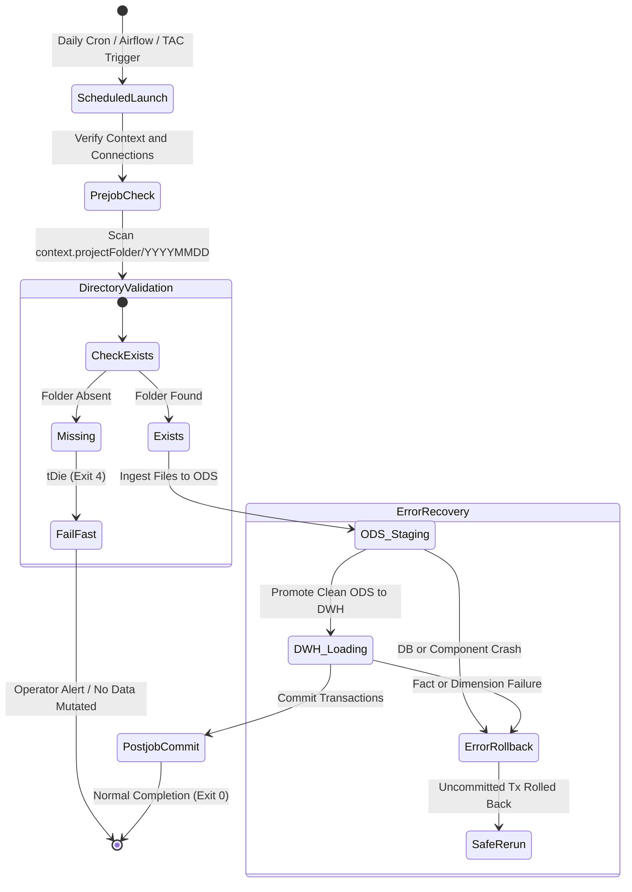

# Job Monitoring, Timing Metrics, Error Handling, and Restart Semantics

## Purpose and Scope

This document details the operational characteristics of the ETL workload, including timing instrumentation, execution exit codes, restartability semantics, and error recovery procedures.



---

## 1. Timing and Performance Monitoring

Every job embeds automated stopwatch instrumentation:
- **Startup:** `tChronometerStart` records epoch millisecond timestamp into `globalMap` (`tChronometerStart_1_STARTTIME`).
- **Teardown:** `tChronometerStop` computes duration in milliseconds (`tChronometerStop_1_DURATION`).
- **Standardized Log Output:** Emitted via `tJava`:
  ```text
  -----------------------------------------------------------------------------
  Début d'exécution du job jAlimentationBDD : 2026-09-16 04:00:00
  -----------------------------------------------------------------------------
  Connexion Base de données OK
  ...
  -----------------------------------------------------------------------------
  Fin d'exécution du job jAlimentationBDD   : 2026-09-16 04:02:15
  Durée totale                             : 02m 15s
  -----------------------------------------------------------------------------
  ```
- **Custom Utility:** Method `customCode.getFormattedTime(long ms)` normalizes millisecond intervals into clean hours, minutes, and seconds.

---

## 2. Exit Codes and Failure Traps

| Exit Code | Trigger Component | Cause | System State & Impact |
| :--- | :--- | :--- | :--- |
| `0` | JVM Settlement | Successful execution | Pipeline completed, transactions committed, watermarks updated |
| `4` | `tDie_1` in `jChargeODS` | Daily folder `YYYYMMDD` absent | Safe fail-fast: no DB writes executed, no stale records processed |
| Non-zero | Component Crash | SQL exception, unique violation, or type conversion failure | Transaction rolls back; uncommitted inserts/updates dropped |

---

## 3. Idempotency and Rerun Semantics

The pipeline provides robust restartability without requiring manual table truncation:

1. **Re-running Ingestion (`jChargeODS`):**
   - If rerun on the same day with identical files, `tUniqRow` identifies previously staged business keys as duplicates, routing them to `ODS_REJET` and leaving existing active rows (`BL_LIGNE_ACTIVE = 1`) intact.
   - If files contain updated attributes, SCD-2 logic smoothly expires the prior version and inserts the updated record.
2. **Re-running Warehouse Mart (`jChargeDWH`):**
   - The sales fact extractor checks `WHERE BL_LIGNE_IN_DWH = false`.
   - Records that succeeded in prior runs will have `BL_LIGNE_IN_DWH = true` and are skipped, avoiding double-counting in `FAIT_VENTE`.
   - Any transaction aborted mid-flight before `tPostjob` commit remains `BL_LIGNE_IN_DWH = false` and will be reprocessed cleanly upon the next invocation.

---

## Evidence Grounding

- Timing snippets: `workspace://codebase/7c8eded6-9911-48de-929c-053e124fc8b5/file/codeForOds.java`
- Component configurations in `jAlimentationBDD_0.1.item`, `jChargeODS_0.1.item`, `jChargeDWH_0.1.item`
