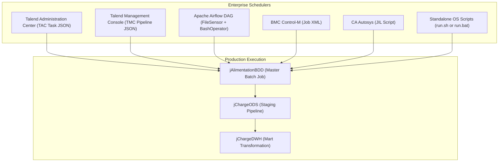

# Production Scheduling, Batch Windows, and Enterprise SLA Profile

## Purpose and Scope

This document defines the enterprise production execution profile, batch operational windows, business SLA cut-offs, failure policies, and scheduler integration contracts for the **Talend Data Warehouse Alimentation** system.

It bridges the gap between design-time Talend Studio `.item` definitions and production operations by providing verified specifications for **Talend Administration Center (TAC)**, **Talend Management Console (TMC)**, **Apache Airflow**, **BMC Control-M**, **CA Autosys**, and autonomous standalone wrappers.

---

## Production Batch Windows and SLA Profile

```mermaid
gantt
    title Daily Commercial Batch and SLA Timeline (Europe - Paris Time)
    dateFormat  HH:mm
    axisFormat  %H:%M
    
    section Ingress Feeds
    Daily CSV Feeds Deposited (Store POS)  :done, 01:00, 03:00
    Ingress Cut-off SLA                    :milestone, 03:00, 00:00
    
    section Batch Execution
    Directory Gate and ODS Staging (jChargeODS) :active, 04:00, 04:15
    DWH Star Schema Loading (jChargeDWH)        :active, 04:15, 04:25
    Postjob Commits and Audit Validation        :04:25, 04:30
    
    section Business Consumption
    Analytical Mart Ready for BI Refresh        :milestone, 04:30, 00:00
    Business SLA Cut-off                       :milestone, 06:00, 00:00
```

| Operational Milestone | Target Time (Europe/Paris) | Technical Policy & Constraint |
| :--- | :--- | :--- |
| **Ingress Delivery Window** | 01:00 AM – 03:00 AM | Point-of-sale store systems push `ICOM_YYYYMMDD_*.csv` feeds overnight. |
| **Ingress Gate Cut-off** | **03:30 AM** | The date directory `{projectFolder}/{YYYYMMDD}/` must exist. If missing, `jChargeODS` aborts with **Exit Code 4**. |
| **Daily Batch Start Time** | **04:00 AM** | Schedulers trigger master job `jAlimentationBDD`. |
| **Execution Run Window** | 04:00 AM – 04:30 AM | Expected run duration is ~5–15 minutes across all subjobs. |
| **Business SLA Cut-off** | **06:00 AM** | Hard SLA boundary. Power BI / Tableau dashboards refresh prior to store opening at 08:00 AM. |
| **Retry & Recovery Policy** | **3 retries at 15-minute intervals** | Transient database locks or file transfer lags recover automatically. Alerts escalate to On-Call after 3 failed attempts. |

---

## Exit Code Standards

| Exit Code | Classification | Cause & System State | Operational Action |
| :--- | :--- | :--- | :--- |
| **`0`** | Normal Completion | Pipeline succeeded, transactions committed, watermarks updated. | Proceed to downstream BI dashboard refresh. |
| **`4`** | Missing Daily Ingress Directory | `tDie_1` triggered in `jChargeODS`. Zero DB writes executed. | Check upstream file transfer into `{projectFolder}/{YYYYMMDD}/`. |
| **Non-zero** | Component Crash / DB Exception | Transaction rolled back; staging uncommitted. | Automatic scheduler retry after 15 minutes. |

---

## Scheduler Integration Contracts

### 1. Talend Administration Center (TAC) Task Descriptor
- Task Name: `TASK_DAILY_ALIMENTATION_DWH`
- Execution Server: `Talend_JobServer_Linux_Prod_01` (Port: 8000)
- JVM Parameters: `["-Xms1024m", "-Xmx4096m", "-Dfile.encoding=UTF-8", "-Duser.timezone=Europe/Paris"]`
- Quartz Cron Trigger: `"0 0 4 * * ?"` in `Europe/Paris` timezone.
- Context Overrides: `ServerName`, `port`, `database`, `schema_param`, `projectFolder`.

### 2. Talend Management Console (TMC) Cloud Descriptor
- Engine Type: `REMOTE_ENGINE`
- Cluster Name: `PROD_REMOTE_ENGINE_CLUSTER_01`
- Run Profile: `Medium_Compute_Profile` (4 vCPU, 8 GiB RAM).
- Secrets: Injected via vault references (`${vault:secret/data/db/password}`).

### 3. Apache Airflow DAG Specification
- Schedule: `0 4 * * *`
- Tasks:
  1. `wait_for_daily_ingress_folder` (`FileSensor`): Monitors `/data/ingress/icommerce/{{ ds_nodash }}` with 2-minute poke interval and 1-hour timeout.
  2. `execute_talend_master` (`BashOperator`): Invokes `jAlimentationBDD_run.sh` passing environment-resolved parameters.

### 4. Workload Automation (BMC Control-M & CA Autosys)
- **Control-M:** Defined under Smart Folder `DWH_ALIMENTATION_DAILY`. Runs daily from `0400` to `0600` with `MAXRUNS=3` and `INTERVAL=15M`.
- **Autosys JIL:** Configured for job `TALEND_DWH_DAILY_ALIMENTATION` with `date_conditions: 1`, `start_times: "04:00"`, `n_retrys: 3`, and `retry_interval: 15`.

---

## Evidence Grounding

- Upstream README note: `workspace://codebase/7c8eded6-9911-48de-929c-053e124fc8b5/file/README.md` (lines 178-179)
- Ingress gate definition: `workspace://codebase/7c8eded6-9911-48de-929c-053e124fc8b5/file/ALIMENTATION_DATA_WAREHOUSE/process/Orechestration/jChargeODS_0.1.item`
- Master orchestrator item: `workspace://codebase/7c8eded6-9911-48de-929c-053e124fc8b5/file/ALIMENTATION_DATA_WAREHOUSE/process/Orechestration/jAlimentationBDD_0.1.item`
- Scheduling package files: `workspace://codebase/7c8eded6-9911-48de-929c-053e124fc8b5/file/scheduling/`
