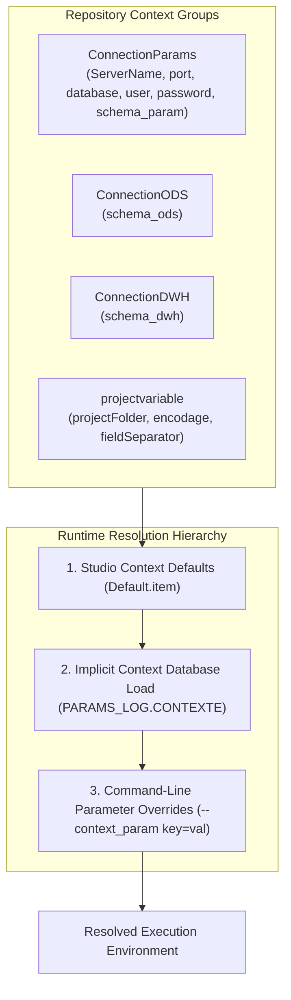

# Runtime Context Groups and Configuration Lifecycle

## Purpose and Scope

Talend manages configuration through **Context Groups**. In this architecture, contexts are partitioned into functional groups and externalized to the database, ensuring zero hardcoding of paths, credentials, or schema names.

---

## Context Group Catalog

### 1. ConnectionParams
- `ServerName` (`id_String`): Defaults to `"localhost"`.
- `port` (`id_String`): Defaults to `"5432"`.
- `database` (`id_String`): Defaults to `"vente_db"`.
- `utilisateur` (`id_String`): Defaults to `"postgres"`.
- `password` (`id_Password`): Encrypted password string.
- `schema_param` (`id_String`): Defaults to `"PARAMS_LOG"`.
- `additionalParam` (`id_String`): Optional JDBC parameters (e.g. `ssl=true`).

### 2. ConnectionODS
- `schema_ods` (`id_String`): Defaults to `"VENTE_ODS"`.

### 3. ConnectionDWH
- `schema_dwh` (`id_String`): Defaults to `"VENTE_DWH"`.

### 4. projectvariable
- `projectFolder` (`id_Directory`): Defaults to `"C:/PROJET_TALEND/ICOMMERCE"`.
- `encodage` (`id_String`): Defaults to `"UTF-8"`.
- `fieldSeparator` (`id_String`): Defaults to `"|"`.

---

## Implicit Context Loading Protocol

All jobs enable `IMPLICIT_TCONTEXTLOAD = true` with database source:
- **DB Type:** `tPostgresqlInput`
- **Table:** `"CONTEXTE"` in schema `context.schema_param`
- **Behavior on Unknown Variable:** Logged as `Info` (`LOAD_NEW_VARIABLE = Info`)
- **Behavior on Missing Variable:** Logged as `Warning` (`NOT_LOAD_OLD_VARIABLE = Warning`)
- **Errors:** Handled without terminating unless database connection fails.

---

## Evidence Grounding

- Context item files:
  - `workspace://codebase/7c8eded6-9911-48de-929c-053e124fc8b5/file/ALIMENTATION_DATA_WAREHOUSE/context/ConnectionParams_0.1.item`
  - `workspace://codebase/7c8eded6-9911-48de-929c-053e124fc8b5/file/ALIMENTATION_DATA_WAREHOUSE/context/ConnectionODS_0.1.item`
  - `workspace://codebase/7c8eded6-9911-48de-929c-053e124fc8b5/file/ALIMENTATION_DATA_WAREHOUSE/context/ConnectionDWH_0.1.item`
  - `workspace://codebase/7c8eded6-9911-48de-929c-053e124fc8b5/file/ALIMENTATION_DATA_WAREHOUSE/context/projectvariable_0.1.item`
