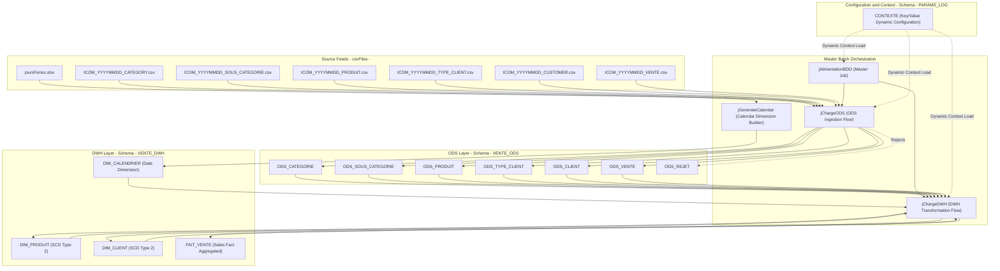

# System Specification Index and Guide

## Executive Overview

This specification pack documents the **Talend Data Warehouse Alimentation** system (workspace codebase `workspace://codebase/7c8eded6-9911-48de-929c-053e124fc8b5`). The system is an enterprise ETL / batch data integration platform built on **Talend Open Studio for Data Integration (v8.0.1)** and **PostgreSQL (v9.x/v12+)**.

The pipeline ingests daily commercial sales and master reference feeds in delimited format (`ICOM_YYYYMMDD_*.csv`), normalizes and deduplicates them into an **Operational Data Store (ODS)** with SCD Type 2 tracking, and loads an analytical **Data Warehouse (DWH)** star schema containing conformed dimensions (`DIM_CLIENT`, `DIM_PRODUIT`, `DIM_CALENDRIER`) and a summarized sales fact table (`FAIT_VENTE`).

---

## Pack Document Navigation

| Domain Folder | Document | Purpose & Scope | Specialist Skill Provenance |
| :--- | :--- | :--- | :--- |
| **System overview** | `readme.md` | Master pack directory, reading guide, and artifact mapping | `system-blueprint-and-specification` |
| **System overview** | `system-architecture.md` | Architectural layers, execution topologies, and runtime stack | `talend-project-inventory`, `legacy-application-discovery` |
| **Batch jobs and orchestration** | `j-alimentation-bdd.md` | Master batch orchestrator connecting ODS and DWH sequences | `talend-job-parser`, `mainframe-batch-jcl-analysis` |
| **Batch jobs and orchestration** | `j-charge-ods.md` | ODS layer coordinator, folder readiness verification, and dependency chain | `talend-job-parser`, `talend-dependency-graph` |
| **Batch jobs and orchestration** | `j-charge-dwh.md` | DWH transformation coordinator and dimension/fact sequencing | `talend-job-parser`, `talend-dependency-graph` |
| **Batch jobs and orchestration** | `j-ods-categorie.md` | Ingestion job for product categories with SCD-2 tracking | `talend-job-parser`, `talend-data-lineage` |
| **Batch jobs and orchestration** | `j-ods-sous-categorie.md` | Ingestion job for sub-categories with SCD-2 tracking | `talend-job-parser`, `talend-data-lineage` |
| **Batch jobs and orchestration** | `j-ods-produit.md` | Ingestion job for products with price validation and SCD-2 tracking | `talend-job-parser`, `talend-data-lineage` |
| **Batch jobs and orchestration** | `j-ods-type-client.md` | Ingestion job for customer classification tiers with SCD-2 tracking | `talend-job-parser`, `talend-data-lineage` |
| **Batch jobs and orchestration** | `j-ods-client.md` | Ingestion job for customer profiles with demographic validation and SCD-2 tracking | `talend-job-parser`, `talend-data-lineage` |
| **Batch jobs and orchestration** | `j-ods-vente.md` | Transactional sales ingestion, key sequence tracking, and rejection handling | `talend-job-parser`, `talend-tmap-analysis` |
| **Batch jobs and orchestration** | `j-generate-calendar.md` | Date dimension generation spanning 2020-2025 with holiday enrichment | `talend-job-parser`, `talend-tmap-analysis` |
| **Batch jobs and orchestration** | `j-dwh-produit.md` | Product dimension loader with hierarchical denormalization and SCD-2 tracking | `talend-job-parser`, `talend-tmap-analysis` |
| **Batch jobs and orchestration** | `j-dwh-client.md` | Customer dimension loader with classification denormalization and SCD-2 tracking | `talend-job-parser`, `talend-tmap-analysis` |
| **Batch jobs and orchestration** | `j-dwh-vente.md` | Sales fact generation with in-memory hashing, multi-dimension joins, and aggregation | `talend-job-parser`, `batch-modernization-restart-semantics` |
| **Data definitions and storage** | `ods-schema-definitions.md` | Physical schema definitions, types, and constraints in `VENTE_ODS` | `database-modernization-and-data-ownership` |
| **Data definitions and storage** | `dwh-dimensional-models.md` | Star schema, dimensional hierarchies, surrogate keys, and foreign keys | `database-modernization-and-data-ownership` |
| **Data definitions and storage** | `params-log-contexte.md` | Key-value schema in `PARAMS_LOG.CONTEXTE` for parameter externalization | `talend-context-analysis` |
| **Data definitions and storage** | `ods-rejet-schema.md` | Audit and error logging data model in `ODS_REJET` | `database-modernization-and-data-ownership` |
| **Data lineage and flows** | `end-to-end-data-lineage.md` | Column-level flow from ingress CSV to star schema fact and dimension tables | `talend-data-lineage`, `data-lineage-and-io-mapping` |
| **Data lineage and flows** | `scd-and-watermark-mechanics.md` | Slowly Changing Dimension Type 2 and watermark flag synchronization | `batch-modernization-restart-semantics` |
| **Business rules and transformations** | `business-rules-catalog.md` | Canonical rule catalog across validation, rejection, deduping, and metrics | `business-rule-extraction` |
| **Business rules and transformations** | `tmap-transformations-reference.md` | Formal specification of tMap joins, filters, expressions, and sequence generators | `talend-tmap-analysis` |
| **Business rules and transformations** | `custom-routines.md` | Custom Java routines (`customCode.java`) and system routine dependencies | `talend-routine-analysis` |
| **Interfaces and contracts** | `file-ingress-contracts.md` | CSV file format, header rules, separators, encoding, and path conventions | `external-interface-contract-mapping` |
| **Interfaces and contracts** | `database-connectivity-contracts.md` | PostgreSQL database connection definitions, schemas, and credentials | `external-interface-contract-mapping` |
| **Operations, SLA, and security** | `runtime-contexts-and-parameters.md` | Context variable definitions, implicit database loads, and environment switching | `talend-context-analysis` |
| **Operations, SLA, and security** | `execution-monitoring-and-restartability.md` | Operational monitoring, execution timings, failure codes, and rerun semantics | `observability-performance-sla-baseline`, `batch-modernization-restart-semantics` |
| **Knowledge gaps and SME backlog** | `sme-question-backlog.md` | Backlog of technical ambiguities, missing schedules, and SME questions | `legacy-knowledge-capture-and-sme-risk` |
| **Modernization plan** | `databricks-modernization-plan.md` | Target Azure Databricks, Delta Lake & Unity Catalog modernization architecture plan | `talend-to-azure-databricks-modernization` |

---

## Codebase Resource Citations

- **Root project file:** `workspace://codebase/7c8eded6-9911-48de-929c-053e124fc8b5/file/ALIMENTATION_DATA_WAREHOUSE/talend.project`
- **Orchestration jobs:** `workspace://codebase/7c8eded6-9911-48de-929c-053e124fc8b5/file/ALIMENTATION_DATA_WAREHOUSE/process/Orechestration/`
- **ODS jobs:** `workspace://codebase/7c8eded6-9911-48de-929c-053e124fc8b5/file/ALIMENTATION_DATA_WAREHOUSE/process/ODS/`
- **DWH jobs:** `workspace://codebase/7c8eded6-9911-48de-929c-053e124fc8b5/file/ALIMENTATION_DATA_WAREHOUSE/process/DWH/`
- **Context groups:** `workspace://codebase/7c8eded6-9911-48de-929c-053e124fc8b5/file/ALIMENTATION_DATA_WAREHOUSE/context/`
- **Database schemas (DDL):** `workspace://codebase/7c8eded6-9911-48de-929c-053e124fc8b5/file/scriptSQL_partie_1/` and `scriptSQL_partie_2/`
- **Custom routines:** `workspace://codebase/7c8eded6-9911-48de-929c-053e124fc8b5/file/customCode.java` and `ALIMENTATION_DATA_WAREHOUSE/code/routines/customCode_0.1.item`
